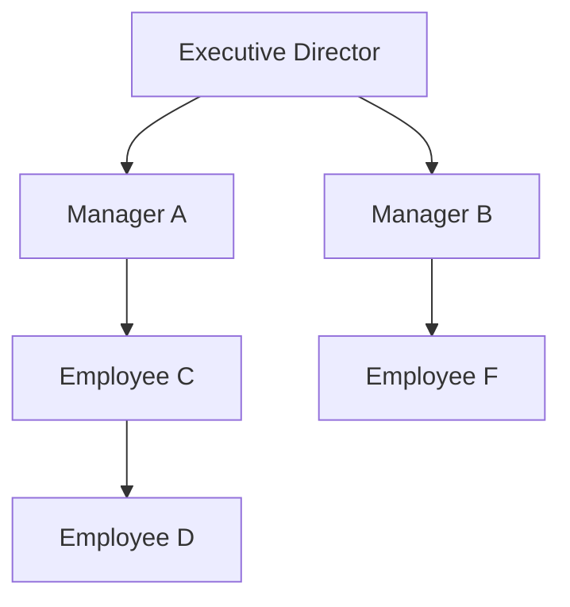

# Employee reporting tree and Task Visibility Scope

An employee reporting tree records who reports to whom. It is an authorization relationship, not a chart inferred from job titles. Each employee has one immediate manager, or no manager at the top. Following those links gives the employee's indirect managers.

For example, within one company:

This is an illustration, not a claim about your actual organization. Manager A can view work tasks for which C or D is In Charge. A cannot automatically view F's tasks, B's tasks, or the Director's tasks. Supporting someone on a task does not put that task in the supporter's manager's branch.

## Set up real reporting relationships

1. Open **Task Management → Users → Reporting lines**.
2. Choose **Manager** beside the employee, select **Reports to**, then **Save**. The Directory profile also has the same field.
3. Use **Nobody** for the top of a reporting tree. Multiple independent roots are supported.
4. Grant company-wide task visibility explicitly through **Task Management · All company tasks → View** (`tasks.company`, `view`) in the authorized account/role settings. Assign that permission only for the company authority the executive should hold.

Changing a reporting line requires **Administration · User accounts → Update** (`admin.users`, `update`). A role named Manager or a job title saying Executive Director does not grant this permission or company-wide task access by itself. Existing Administrator accounts retain their explicit full access.

Self-management, direct and indirect reporting cycles, inactive managers, and employee IDs outside the current company are rejected. Reporting changes are recorded in task-management activity. Failed profile changes roll back completely.

## Employee identity and company boundary

The existing database model is reused:

| Concept | Existing representation |
|---|---|
| Stable employee ID | `lookups.id`, referenced by `tm_profiles.staff_id` |
| Immediate manager | `tm_profiles.manager_id`, referencing an employee in the same company database |
| Company scope | Company selected by `/c/<companyId>/…`, with its own SQLite database, accounts, roles and sessions |
| Effective employee identity | The pair `(companyId, staff_id)` |
| Task hierarchy branch | `tm_tasks.pic_id` — the accountable employee / In Charge |

Two companies can both contain a local ID such as `STAFF-001`; those are different employees. A session or reporting relationship in one company grants no access in another. There is no new cross-company reporting feature or schema migration in this update. Managers must be maintained through the application's authorized commands.

## Who can view a task?

| Situation | Result |
|---|---|
| Existing direct involvement: In Charge, support assignment, reviewer, assigner, creator or a pending decision recipient | Existing task visibility continues |
| Direct or indirect manager of the task's In Charge | May view the task and its authorized task-related records |
| Explicit `tasks.company` View permission | May view company work tasks, subject to the relevant module permissions |
| Same company, peer, subordinate or separate branch only | No additional task access |
| A report supports a task whose In Charge is in another branch | Does not grant that report's manager visibility |
| Someone opens or views a task | Does not grant anyone else visibility |
| Personal Calendar note | Owner only, including when a manager or executive has company-wide task visibility |

Existing assignment/review/decision involvement remains an explicit access path. This product has no separate arbitrary task-sharing ACL to migrate. Existing meeting sharing and Group access controls are preserved; neither is used to expand the task's hierarchy branch. Adding task sharing later must stay within the authorized company boundary and use the same backend scope.

**Viewing does not grant editing, reassignment, approval, deletion, comments or closure.** Those actions still need their existing task relationship, workflow and function permissions. Even a company-wide viewer does not acquire those actions merely by seeing the task.

The existing exception for a person's own time entries is retained: they can still see their own recorded time and a limited task reference after leaving a task. That does not reopen the task's details or give their manager access to a hidden task.

## Private tasks and personal information

There is no separate “strictly private task” flag in the current task schema or workflow. A task led by a superior is hidden from a subordinate unless an existing direct relationship or explicit company permission grants access. An ordinary work task someone assigns to themselves is visible to their own authorized managers.

Personal Calendar notes and Personal Groups have separate privacy protections, and those protections remain unchanged. This release does not add an override for strictly private tasks. If a separate privacy rule is introduced, its interaction with hierarchy must be defined before granting hierarchy access to those records.

## Notification conditions

Visibility and notification subscription are separate. A manager or director does **not** start receiving every visible task's notifications.

| Notification | Existing recipient rule retained |
|---|---|
| Task invitations, task updates and deadline reminders | The applicable task participants under the existing workflow and reminder settings |
| Approval / change / due-date decisions | The existing decision recipient and affected task participants |
| A completed Step of Work | The existing assigner notification; no automatic task closure |
| Task request | Requester and current receiver as applicable; forwarding updates the receiver |
| Meeting | Participants and permitted followers, using existing sharing/reminder rules |
| Personal Calendar note reminder | The note owner only |
| Hierarchy-only or company-wide viewer | No automatic subscription |

Telegram delivery additionally checks the active account, access, linked Telegram account and notification preferences. Queued messages are checked again before sending. Task messages require direct task involvement; hierarchy visibility alone is insufficient. Previously delivered Telegram messages cannot be recalled by a visibility change.

The in-app inbox now hides a notification when any linked task, meeting, request or personal note is no longer visible. In particular, forwarding a request no longer leaves its title and body in the former receiver's inbox.

## One backend scope, both clients

`source/local-test/task-scope.mjs` remains the single task visibility implementation. ERP Web, Telegram Mini App and the bot use it through the backend for state, task details/actions, search data, counts, dashboard sources, reporting, exports, task files and Calendar deadlines.

Report employee choices now come from the already-authorized records. The separately permissioned employee directory and assignment/request pickers remain available under their existing rules, so this does not stop authorized users from assigning or requesting work across teams.

Scope is recalculated on every backend read. Reporting changes and normal commands advance the existing change sequence. The server also returns an opaque scope revision incorporating the authorized record set, reporting descendants, account and effective permissions. Cached task reports, central reports, dashboard data and record explorers are discarded when that authority changes.

ERP and Mini App normally poll every four seconds while visible. The Mini App monthly report now refreshes with those changes, retains its chosen month/scope/category and ignores late responses from an older scope. Existing polling pauses during editing remain to protect unsaved forms; backend authorization is immediate even while an old form is open. Offline clients cannot refresh until they reconnect.

## Verification and deployment

See **CHANGES_AND_TESTING.md**. Tests use isolated sample databases and locally signed Telegram launch data; no real employee relationships, production database, bot messages or external deployment were changed. Apply the actual organization chart through the existing administrator interface after installing the package.
