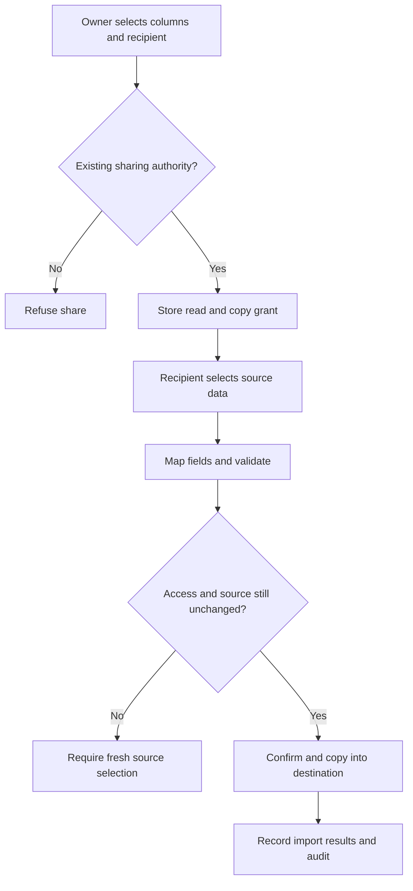
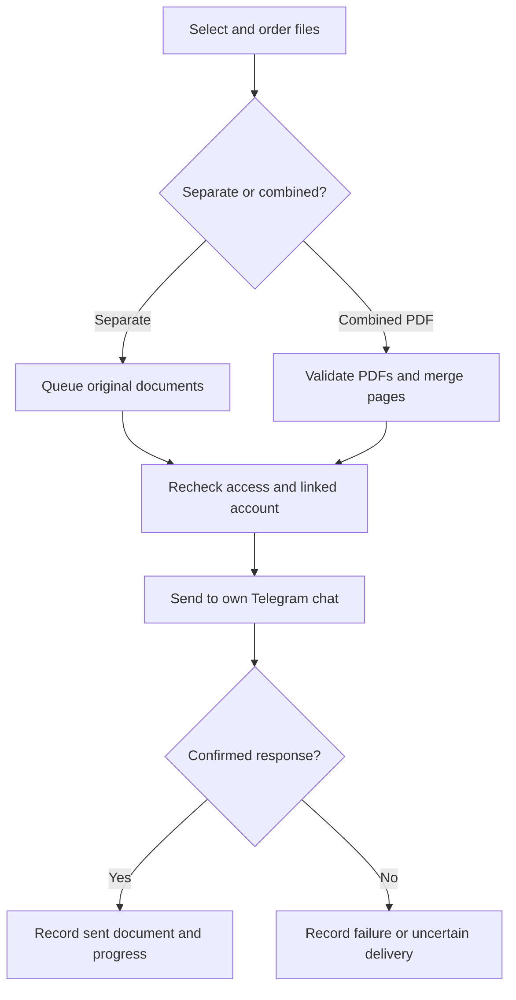

# Groups, attachments and Telegram — implementation report

18 October 2026 · Development branch: `feature/groups-mobile-sharing`

Built on `feature/restore-groups-attachment-preview` at `09154e3cfe25ee55967426acaf2bb2b9a1d13457`.
This is an additive change to the existing React/Django/SQL Server system. No production database or running service was accessed or changed during implementation.

## What changed

| Area | Implemented behavior | Where to use it |
| --- | --- | --- |
| Sidebar | Keeps the original 15.5rem default; drag the right edge from 224–384px; Arrow keys resize; Home/double-click resets. Width is remembered in this browser. Larger navigation items and child icons; distinct rectangular branding panel using the original logo. | Office web sidebar |
| Number / Formula display | General, USD, Cambodian Riel, Percentage, custom prefix/suffix, separators and 0–6 decimals. Stored values and calculations keep their original precision. | Column menu → Rename or change column / Edit formula and column |
| Individual cell colors | Presets and custom text/background colors; saved separately from values; row-version conflict protection. | Palette button in a table cell or card field |
| Attachment panel | Wider responsive panel, wrapping filenames and fixed-size Download / Remove controls. | Open an Attachment cell |
| Telegram delivery | Ordered multi-file selection, separate files or one merged PDF, queued progress, sent-file list and clear failure states. Same service in web and Mini App. | Attachment panel → Send to Telegram |
| File navigation | Previous File / Next File stays within the opened Attachment cell; PDF page controls remain separate. | Attachment preview |
| Share Data | Revocable read-and-copy grants for selected columns, with recipient selection constrained by organizational collaboration rights. Does not add workspace membership or source editing rights. | Column menu → Share Data |
| Internal import | Source Group → columns → rows → field mapping → matching key, if updating → validation → confirmation → results. Reuses the existing XLSX conversion and import engine. | Import data → Another Group / shared data |
| Mobile Tasks | New Task and Request Task remain separate actions inside Tasks. Requests remain accessible from Tasks and dashboard review links. | Mini App → Tasks |
| Mobile Groups | My Groups / Company authorized scope, workspace and Group selectors, column/type selection, saved personal columns, search/status filters, paging, permitted cell edits, attachments and delivery. | Mini App → Groups |
| Mobile PDF viewer | Vertical scrolling through PDF pages, nearby-page canvas rendering, zoom, page navigation, same-cell file navigation, download and close. | Mini App file preview |

Percentage is deliberately **display-only**: stored `25` shows as `25%`; stored `0.25` shows as `0.25%`. USD defaults to two decimals and KHR to zero when precision is Automatic. Numeric filtering, matching and sorting continue to use the existing raw-value rules. Currency symbols do not convert currencies. Cell colors are not copied by an internal data import; imported values are independent records.

## Permissions and data sharing

A sender needs Group management access plus the Groups Update and Export permissions. A recipient needs an active account and Groups View. Importing into a destination also requires its existing record-edit/Create permissions. Ordinary accessible Groups require source Export permission; an explicit data-copy grant can authorize the selected source columns without granting full source access.

Existing row restrictions, column restrictions and formula-dependency restrictions still apply to recipients. Outside-workspace recipients require the issuer's existing `collaborate_outside` authority; personal-workspace ownership follows the current governance service. Personal Groups stay private except for the explicit shared data. Source names and selected data can appear in the recipient's import picker; unrelated workspace metadata, columns, source formulas and record editing are not granted.

Source formulas are copied as their calculated values into Number columns. Sharing a formula requires sharing its input columns. Text, Number, Date, Status, In Charge and Support are converted by the existing import engine. Attachment columns are excluded from internal copying. People who cannot be selected in the destination and incompatible values are reported by validation.

The backend rechecks sharing, organizational scope and a source-data fingerprint when opening, previewing or committing a pending internal import. Revocation, changed columns/rows, changed source values or lost issuer authority block that pending copy. Revocation does not erase copies that were already completed. Retried commits return the first import result instead of inserting duplicate rows. Source rows are never changed by the copy.

## Telegram delivery

The backend derives the recipient from the authenticated employee's private Telegram link. Client-supplied recipient fields are refused. Every selected file must belong to the same Attachment cell and be currently visible to the sender. The worker rechecks account, Group/file permission, bot availability and the exact Telegram link before each outbound document.

- Up to 20 selected files per request; current Group upload limit remains 30 MB per file. Each outbound document is limited conservatively to 50,000,000 bytes.
- PDF merging requires at least two PDFs, at most 100,000,000 input bytes and 1,000 pages. Password-protected, unreadable, empty and oversized PDFs are refused.
- Page order follows the user's selection. Original bytes stay unchanged. Merging happens in memory; no temporary disk files are created. Visual annotations are retained while page/annotation actions are removed. A merged PDF is a new document; do not treat it as preserving original digital signatures or all interactive form behavior.
- Separate files are loaded for sending one at a time. The queue stores file IDs, not duplicate file contents.
- At most three pending requests per user and 30 requests per hour. Request UUIDs prevent duplicate queue creation after a retry.
- `QUEUED → SENDING → SENT`, or `PARTIAL`, `FAILED`, `UNKNOWN`. An interrupted SENDING job older than ten minutes becomes UNKNOWN. Timeouts that could have delivered are never retried automatically. Check the chat before submitting another request; select only the files still needed.
- Runs in a dedicated loop in the existing `run_workers` process. Network requests run outside database transactions and the command lock. `--no-telegram` disables the delivery loop too.

Telegram document limit reference: [official Bot API sendDocument](https://core.telegram.org/bots/api#senddocument). PDF implementation: [pypdf merging documentation](https://pypdf.readthedocs.io/en/stable/user/merging-pdfs.html), pinned dependency `pypdf==6.21.0`.

## Components and migration

| Component | Changes |
| --- | --- |
| `backend/groups/models.py`, migration `0003_presentation_sharing_delivery` | Add `BoardImport.source_json` with an empty-object default; new `tm_board_cell_styles`, `tm_board_data_shares`, `tm_board_deliveries`. No existing task, user, workspace, row-value or file column is replaced. |
| `backend/groups/presentation.py`, `service.py` | Validate numeric presentation settings, save cell colors, filter returned styles by visible columns, optional deferred file-content reads. |
| `backend/groups/sharing.py`, `imports.py` | Explicit copy grants, scoped source reads, source snapshots, validation and existing import engine integration. |
| `backend/groups/delivery.py`, `core/workers.py` | Idempotent queue, private recipient binding, PDF merge, authorization rechecks, delivery progress and audit. |
| `compat/authorize.py`, `groups/views.py`, `config/urls.py` | New commands and read routes through the existing authentication/authorization boundary. |
| `telegram/gateway.py`, `core/mini_boundary.py`, `compat/reports.py` | Scoped Group state, exact allowlisted Mini App Group endpoints and authenticated media. Office endpoints remain excluded from the public Mini App listener. |
| `source/local-test/groups-ui.tsx`, `group-*.tsx/ts` | Formatting, colors, sharing, internal import and reusable delivery interface. |
| `source/local-test/tg-app.tsx`, `tg-groups.tsx`, `file-preview.tsx` | Task action organization, mobile Groups, same-cell navigation and continuous PDF viewing. |
| `source/components/ui/sidebar.tsx`, `local-test/ui.tsx`, styles | Bounded width, keyboard/pointer controls, icons and branding presentation. |

New office reads: `/api/tasks/group/{shares,import-sources,import-source,delivery}`.
New commands: `tm.group.{cell.format,data-share.save,import.internal,delivery.create}`.
New Mini App reads: `/tg/api/{group,group-rows,group-members,group-delivery,group-file,group-file-preview}` beneath the company prefix. Mini App commands allow only row updates, personal view saving and delivery creation from the new Group capabilities.

All Group records and attachments continue to use the same Django database. The legacy Node/SQLite server is retained as a regression reference; these enhancements target Django, not `npm start`'s old Node API. Google Sheets synchronization remains unavailable.

## Verification and remaining release gates

Automated results are recorded in [TEST_RESULTS.md](TEST_RESULTS.md). The suite checks privacy, revoked shares, numeric integrity, stale edits, matching-key imports, copied-data independence, signed Mini App access, media tokens, delivery failures, merge order and migration preservation.

**Staging still required:** actual SQL Server migration/rollback rehearsal; authenticated web/mobile visual testing (including an actual Telegram client); real delivery through a dedicated test bot; large-file/row-volume checks on the office server. No production deployment or real Telegram send was performed. Chromium was unavailable for the existing browser acceptance test. Do not describe this branch as production accepted until the staging checklist in [DEPLOYMENT.md](DEPLOYMENT.md) is complete.
