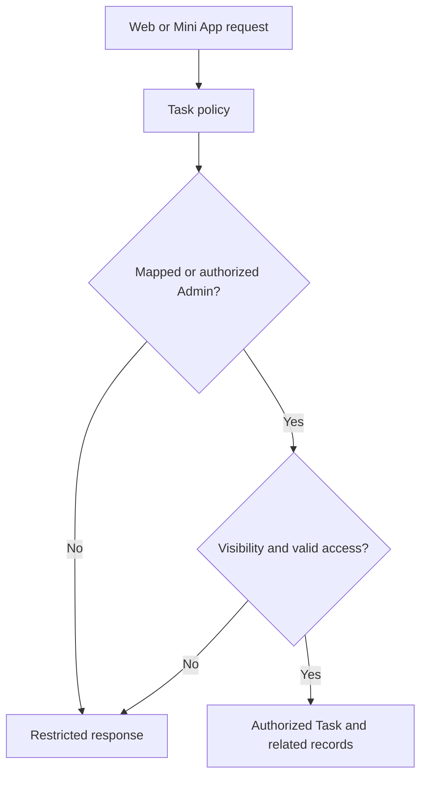
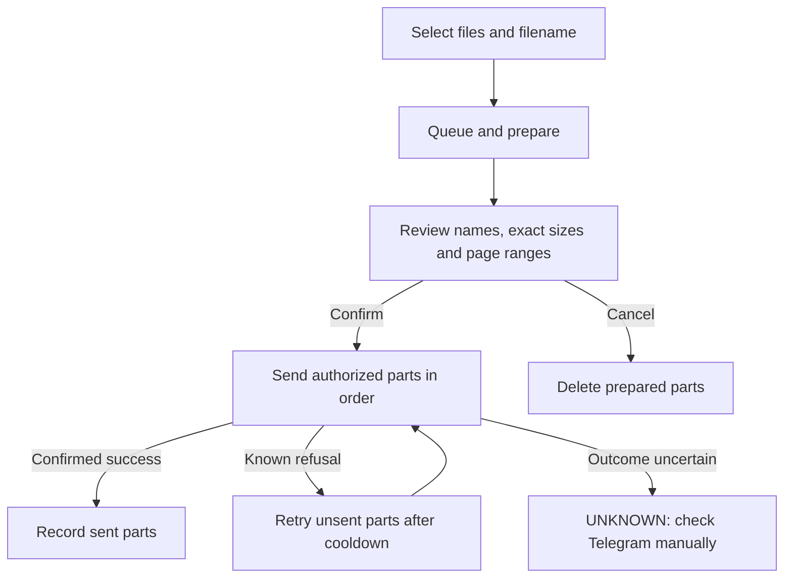

# Task privacy, Telegram documents and camera review

Reviewed against **Pasted text(7).txt**. Review date: 22 October 2026 (Cambodia).

Source: `codex/task-visibility-camera-telegram-wip-2026-10-21`, commit
`0c848c08b01bbccf56525e3fa93f371edd718c25`, based on `352e1d6c960e48f38ef9a974ab071074df17b715`.
Corrections are published separately on `codex/review-task-privacy-camera-2026-10-22`.
No production database, Windows service or hosted application was changed during this review.

## What was already implemented

The reviewed commit adds the central Task policy, Task sharing, three Task categories,
visibility choices, restricted state for unmapped employees, shared Task/Group document
delivery, prepared PDF parts and camera capture in the web application and Telegram Mini App.
The review builds on those changes. The older Node application remains a historical reference;
the deployed target is the React frontend with the Django backend.

## Confirmed defects corrected

| Finding | Correction and evidence |
| --- | --- |
| A Workspace's old primary governor could see a Task assigned to a different selected manager. | Explicit Workspace scope now takes precedence. Organizational Tasks store a selected authorized Level 2 manager; both interfaces offer the same choices. Regression tests cover two reporting managers and an unselected governor. |
| An Administrator participating in their own Task was classified only as an administrator observer. | Direct participation takes precedence, preserving the workflow controls appropriate to that participant. |
| Unmapped employees could regain operational access when Organizational Structure was disabled. | Level assignment is required independently of the enabled switch. Existing Administration bootstrap and authorized structure permissions remain available; Level 1 approval rules are unchanged. |
| Direct profile-photo URLs and Telegram summaries had paths around the unmapped restriction. | Unmapped employees cannot fetch other employees' photos. Bot counts, notifications and daily digests apply the operational/Task policy. Own photo access remains available. |
| Bot replies in group chats could expose Task details to people whose Task access was not checked. | Task commands, reports, attachments and callbacks require private bot chat or the Mini App. Group connection management remains; group help and command registration describe the restriction. Previously posted Telegram messages are not removed. |
| Failed prepared PDF deliveries had no safe recovery path; expired workers could still update a job. | Known failures retain prepared parts temporarily and can retry only unsent documents. Claims have heartbeats and ownership checks. Interrupted or ambiguous sends become UNKNOWN and cannot use the retry action. |
| Configured document threads were not bounded by a capacity check across worker processes. | A CPU/RAM configuration ceiling, default of one slot, database-serialized claims and one active job per recipient limit concurrency. Server load testing is still required before increasing it. |
| Camera fallback and state updates were fragile on older browsers/React development mode. | Added an Image decoder fallback, moved photo/URL side effects out of state updater callbacks, stopped camera tracks before opening the picker, and allowed retaking the twentieth photo using the picker. |
| Mini App file order could change after final preparation. | Prepared selections and order controls are locked until cancellation/reset. Exact byte sizes are shown. The retry control refreshes after Telegram's cooldown. |

Task visibility and manager changes continue through the existing Task change/approval path.
Request approval retains the proposed governance scope. Sharing changes do not replace the
PIC, reviewer or supporting people. Existing single-person approval regressions also pass.

## Why Workspace access exposed Tasks

The old authorization treated Workspace membership, ownership or broad organizational access
as sufficient to include its Tasks. A readable Workspace is a container, not permission to
read every work record inside it. `tasks/policy.py` now decides Task access, and `TaskScope`
uses that decision for state, details, child records, reports, calendar data and notifications.
File downloads and document delivery check the same current authorization.

## Task access matrix

All entries also require an active login and the relevant function permissions. Seeing a Task
does not itself authorize approval, reassignment, completion or cancellation.

| Access relationship | Personal | Public | Organizational | Additional authority |
| --- | --- | --- | --- | --- |
| Task creator/owner | View | View | View | Existing workflow; manages visibility and explicit shares |
| PIC, reviewer, supporter, assigner or pending approver | Owner only | View | View | Only their existing workflow role |
| Explicit VIEWER | Not accepted while Personal | View | View | Read files/history; no contribution or workflow rights |
| Explicit CONTRIBUTOR | Not accepted while Personal | View | View | Notes and attachments where the Task state/function permissions permit; no approval rights from sharing alone |
| Workspace member or owner, with no other right | No | No | No | Workspace access alone is insufficient |
| Authorized management branch | No automatic access | Applicable Workspace scope | Selected Level 2 manager and authorized primary upline, within Workspace scope | Management visibility does not replace Task approval roles |
| Unselected reporting manager | No | No from that management relationship | No from that management relationship | Can still have independent participation or explicit sharing |
| Authorized global Administration | Preserved | Preserved | Preserved | Existing Administration and workflow rules |
| Unmapped ordinary employee | No | No | No | Login/navigation available; administrator must assign a level |

**Personal:** owner only, with preserved authorized Administration access. To collaborate,
change visibility explicitly first. Existing other responsible people or shares prevent
conversion to Personal until resolved through the relevant workflow.

**Public:** owner managed, visible to authorized participants/shares and applicable management.
It does not mean company-wide access.

**Organizational:** requires an Organizational Workspace and an authorized Level 2 scope.
Select a governing manager when more than one is eligible. Historical records without a
Task-specific manager use the Workspace governor only within the permitted Workspace scope.

**Categories:** My Tasks includes direct responsibilities; Tasks Under My Management includes
authorized non-Personal management work; Shared With Me includes explicit shares. The same
Task may belong to several categories, but appears once within each category. The Mini App's
Company view provides categories with employee, Workspace, status and date filters.

**Administration:** an ordinary unmapped user receives empty/restricted operational state and
direct API denial. Assignment recalculates access on subsequent requests. Existing bootstrap
Administration can initialize the structure. After initialization, existing Level 1 and
delegated authority checks still apply; Create permission alone does not grant Level 1 power.

## Telegram document design

Both Task attachments and Group attachment cells use `groups/delivery.py` and the same durable
queue. Delivery is to the requesting user's currently linked private Telegram account.
The caller cannot choose an arbitrary recipient. Group selection stays within one attachment cell.

The reviewed default calls the public `https://api.telegram.org` **sendDocument** endpoint using
multipart upload. `TELEGRAM_API_BASE` can override that address; the deployed server's environment
was not inspected. Telegram documents a 50 MB upload limit and an official local Bot API server
alternative with uploads up to 2,000 MB. The current solution keeps the public API and splits
merged PDFs by measured output size, at a conservative **50,000,000 bytes per part**.

Official reference, checked during review: <https://core.telegram.org/bots/api#senddocument>
and <https://core.telegram.org/bots/api#using-a-local-bot-api-server>.

Limits remain explicit: up to 20 attachments, 100,000,000 source bytes and 1,000 PDF pages
per delivery. Existing attachment upload limits still apply. Encrypted/damaged PDFs and a
single page that cannot fit within the output limit are rejected with guidance. Splitting
preserves page sequence and does not rasterize or deliberately reduce image quality. Original
attachments remain untouched. Combined PDFs are new documents; active actions are removed,
and interactive features/bookmarks are not promised to survive the merge.

Prepared merged bytes are temporarily stored in `tm_delivery_parts`. Ready jobs and retained
known-failure parts expire after 24 hours when workers run cleanup. Successful, cancelled and
unknown deliveries release temporary parts. These bytes can consequently appear in database
backups; apply the same access controls and retention policy as other company attachments.

Claims are serialized with the existing database write lock; PDF/network work runs outside
that lock. One `TMWorkers` process retains the single Telegram poller and runs configurable
document threads. Independent recipients can be processed concurrently; jobs for the same
recipient are serialized and paced. A heartbeat maintains ownership while work runs. Current
file access and Telegram link identity are checked before each outgoing document.

Start with `DOCUMENT_WORKERS=1`. `check_document_capacity` reports the local CPU/RAM estimate
and configured cap (maximum four slots). This is a heuristic, not a memory reservation or
proof that SQL Server has spare capacity. The review machine reported 9 logical CPUs,
9.7 GiB RAM, a ceiling of two and one configured slot. This is **not your Windows server's
capacity**. Measure SQL, web latency, CPU, memory and database growth there before increasing.
Python threads do not guarantee faster CPU-bound PDF processing.

A local Bot API server was not installed or enabled by this review. It would require a separately maintained
service, API credentials, secured storage/networking, configuration/verification of transport and download URLs,
bot cutover and integration/load tests. Raising a frontend size limit alone is insufficient.

## Camera workflow

In Task or Group attachments on web/Mini App: **Camera → Single photo or Multiple photos →
Open camera/device picker → Capture → Review → Retake/delete/reorder → Name → Confirm/upload**.
Multiple photos upload as one PDF in the selected order; they are not also uploaded separately.
Single-photo mode uploads a JPEG. Maximum 20 photos; the existing attachment byte limit applies.

Live camera uses browser permission and a secure context. On the office HTTP address, the
device camera/photo picker is the fallback. Image orientation is requested from the decoder;
photos are scaled to a maximum 2,000-pixel edge and JPEG quality 0.88 before upload. Review
small text for readability. Tracks stop on close/interruption, and temporary object URLs are
revoked. The Image fallback supports browsers without `createImageBitmap`; unsupported formats
show a request to use a JPEG. Real iOS/Android Telegram permission and orientation behavior
remain manual checks. No camera-device screenshots were captured in this review.

## Migrations and compatibility

From the user's earlier deployment, the feature commit includes `tasks.0002` (visibility,
TaskMember) and `groups.0005` (shared delivery target, preparation state, temporary PDF parts).
This review adds **tasks.0003** (nullable governing manager on Task and TaskRequest) and
**groups.0006** (nullable retry cooldown). No records are deleted or reassigned by these two
new migrations. The upgrade test preserves existing Task visibility, files, history, shares
and a ready delivery. This test uses SQLite; SQL Server migration/locking behavior must be
verified on a restored staging copy.

Do not mix old/new web, Mini App or workers. Older workers cannot safely interpret the new
queue states/Task targets; older authorization code also ignores the new privacy choices.
See [DEPLOYMENT.md](DEPLOYMENT.md) for coordinated deployment and rollback.

## Verification and remaining checks

See [TEST_RESULTS.md](TEST_RESULTS.md) for commands and results. Local functional tests cover
Task privacy, explicit share removal, manager separation, request governance, web/Mini API
consistency, unmapped users, Administration onboarding, PDF splitting/order, retry cooldown,
unknown send outcomes, bounded claims, revoked delivery access, camera PDF validity and
populated-schema upgrade preservation.

Still required on staging: SQL Server upgrade/restore and concurrent claims; representative
50 MB+ collections and peak memory; real Telegram success/429/interruption behavior; desktop
visual review and iOS/Android Telegram camera permissions, orientation, retake/reorder/upload;
refresh across two signed-in clients; and the organization's acceptance tests. There is no
production backup/restore evidence or screenshot evidence from this review. Treat this branch
as a **staging candidate**, not a production certification.
