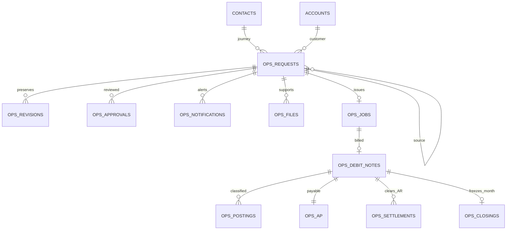
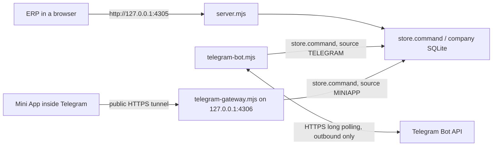

V5.6.5 starts empty and fixes Reporting relationship exit. Read ../../CLEAN_START_AND_EXIT_FIX.md.
The current test suite has 276 backend/API checks.

V5.6.4 includes the Workspace management revision described in ../../WORKSPACE_MANAGEMENT_REVIEW.md.
Use npm test from source for all 268 backend/API checks.

# Sunny ERP V5.5.1 — Task visibility, Calendar, Groups and Google Sheets

V5.5.1 (2 Oct 2026) follows up on V5.5 after it was tried (no schema change; a
V5.5 database is used as it is):

- **Groups, selecting rows like Excel** (groups-ui.tsx `GroupBoard`): the
  selection column is gone. The row-number cell is the handle — pointer events
  with capture select a contiguous range while dragging (rows found by height,
  so sideways drift doesn't matter; the table auto-scrolls near its edges via
  `requestAnimationFrame`), Shift extends from the anchor, Ctrl/⌘ toggles,
  touch taps toggle and drags add (`touch-action: none` on the number cells
  only), `contextmenu` opens the row menu (bulk actions when the row is part
  of a multi-row selection). Each number is a button with `aria-pressed`;
  Space/Enter toggle, Shift+Arrows extend, Ctrl+A selects the page, Escape
  clears, Menu/Shift+F10 opens the row menu. While rows are selected the
  selection bar is laid over the row-count line (absolutely positioned, same
  height), so the table never moves under the pointer and the toolbar stays
  usable; background refreshes wait until a drag ends. The Shift anchor is a
  row id, not a position, so a refresh that inserts rows can't shift it.
- **Groups, one toolbar**: Task Management's page header and section tabs are
  not rendered while a group is open (`useOpenGroup` lifts the open group to
  `TaskManagement`); the group's title row is replaced by a back button, the
  name/switcher on the row-count line and a More menu. Toolbar buttons that
  don't fit move into More by priority (`FIT_ITEMS`, measured with a
  `ResizeObserver`). Re-choosing "Groups" in the sidebar (`erp:reselect`)
  returns to the list.
- **Groups, Enter**: saves in the background and moves at once to the same
  column in the next row (its text selected, as in Excel); a value the column
  can't take stays in its editor. On the last row of the table a row is added
  (`tm.group.row.add`) and opened, unless that last row is still empty or a
  search, filter or sort is on; across pages it opens the next page. IME
  composition Enter is ignored. A cell shows the value being saved
  (`CellState.shown`). Rows to open wait in `pendingOpen` (a list; each is
  settled only by a page load started after it). Keys typed meanwhile are
  caught in the capture phase (`TypeAhead`: one entry per row, Enter starts
  the next, Escape/Tab/a click end it) and `resume` replays them once the row
  is there — saving, adding further rows or opening the editor exactly as if
  each key had arrived in time — so nothing reaches the cell that was left.
  Escape cancels and Tab or a click keep what was typed (and give the keyboard
  back at once); a run of rows typed ahead frees the keyboard after 10 s at
  most. A new row is only ever followed by further new rows (a row someone
  else added meanwhile is never typed into), and the next page's first row is
  not typed into blindly while a search, filter or sort decides it. If the
  reload fails, what was typed for a new row is still saved in it by id. The
  row being added is drawn under the table meanwhile (`ghost`, a second
  `tbody`, settled in a layout effect so it never shows twice). `load` reads
  the current query from a ref, so a reload started by an older render (after
  a save) can't bring back another search's rows; a failed refresh shows on
  the row-count line with Try again.
- **Dialogs**: Settings & sharing's tab panels now pass the dialog's height
  to the form (flex column, `min-height: 0`), so the body scrolls instead of
  being cut off.
- **Mini App calendar** (tg-app.tsx `CalendarView`, `MeetingView`,
  `MeetingForm`, `NoteForm`): the gateway now sends the meetings the person
  may see (`tm_meetings`, `tm_attendees`, `tm_meeting_shares`,
  `tm_meeting_followers`, already filtered by the Task Visibility Scope and
  the Meetings permission) and only their own `tm_calendar_notes`, and accepts
  `tm.meeting.save|follow` and `tm.calnote.save|delete` (`MINI_APP_ACTIONS`);
  the ERP's command rules decide everything else. Deep links `?meeting=`,
  `?note=` (and start parameters `meeting_…`, `note_…`); meeting and note
  notifications get an "Open in the calendar" `web_app` button.
- **Fixes**: `saveMeeting` keeps a meeting's link to a task the person
  changing it can't see, and keeps the link when `task_id` is left out; the
  meeting's `contact_id` is hidden with that task (task-scope.mjs). From a
  separate review: `authorize` trims padded IDs before any check (a meeting ID
  with a space or tab could skip the CRM-activity permission check, reachable
  from the Mini App since this version) and `saveMeeting` checks
  `crm.activities` update for a meeting linked to an activity; changing a
  finished meeting no longer re-adds its attendees to a workspace they were
  removed from (`people(…, known)`); `zonedToIso` moves a time that doesn't
  exist (clocks going forward) forward, not back.

Tests: `node local-test/v551-test.mjs` (5 checks).

V5.5 (2 Oct 2026) extends Task Management, Groups and the Telegram Mini App
(details in "V5.5: visibility, calendar, Groups and Google Sheets" below):

- **Task Visibility Scope** (task-scope.mjs): one rule for every screen, the
  bot, the Mini App, reports, exports, the calendar, the CRM history and every
  command — direct involvement, reporting lines (`tm_profiles.manager_id`, by
  person in charge, direct and indirect) and company-wide access
  (`tasks.company`). Hierarchy and company access are view-only and never
  notify; hidden records answer 404 like missing ones.
- **Notifications** to directly involved people only, re-checked when
  delivered, with a durable, deduplicated Telegram outbox
  (`tm_notification_deliveries`).
- **Tasks**: "Expectation" (the `description` field), optional Steps of Work
  (`tm_checklist`; notify the assigner once, no approval, never close or move
  progress), and two-party approval of progress in both directions.
- **Calendar** (calendar-ui.tsx): Month/Week/Day/Agenda over meetings, task
  deadlines, private notes (`tm_calendar_notes`) and CRM activities; meeting
  privacy (`share_scope`, `tm_meeting_shares`), reminders with offsets
  (`reminder_offsets`, `tm_event_reminders`) in each person's time zone.
- **Groups**: row notes with history, row/column access rules, personal and
  default layouts, resize/drag with keyboard alternatives, selection with
  all-or-nothing bulk delete, real .xlsx export, an 8-step .xlsx import, and a
  Groups ↔ Google Sheets sync (group-sync.mjs, google-api.mjs) tested against
  a local stand-in (google-fake.mjs) — SIMULATED, not verified with Google.
- **Mini App**: My Tasks / Company with filters in the same scope.
- **Look**: blue sidebar and the original red dragon logo.

Schema version 12 (tasks.mjs). Tests: `node local-test/v55-test.mjs` (20
checks: the request's acceptance checks 1–16) and
`node local-test/v55-security-test.mjs` (15, after an independent review);
see Validation.

V5.4 (29 Sep 2026) focuses on Task Management and the Telegram Mini App:

- **Two-party approval** of task updates, completion and cancellation between
  the assigner (`tm_tasks.assigned_by`) and the person in charge: a change
  request (`tm_change_requests`) goes to the other party, who approves (the
  change is applied) or rejects it (nothing changes); the history keeps who
  asked, what changed (previous → new), who decided and when, from which
  interface. Same rules in the ERP, the bot and the Mini App (task-domain.mjs).
- **Participant-only notifications** (person in charge, assigner, reviewer,
  supporting people; never the actor) and **per-task deadline reminders**
  (`tm_tasks.reminder_days`, 1–5 reminders 1–90 days before; default 1 day).
  The bot no longer posts task updates into linked Telegram group chats.
- **Mini App dashboard**: "Assigned by me" replaces the "Supporting" card; In
  my charge, Assigned by me, To review or approve, To accept or reject,
  Overdue, Stuck. ERP Tasks quick views match.
- **Groups** (Task Management → Groups): customizable tables inside a
  workspace with Text, Date, Number, Status, In Charge, Support and Formula
  columns, a restricted formula language computed by the server, personal or
  team sharing with access levels, and a new permission function
  `tasks.groups`. Rows are records of their own and never create tasks.
  Internally a group is a "board" (`tm_boards`, `tm_board_columns`,
  `tm_board_rows`, `tm_board_access`), distinct from Telegram group chats
  (`tg_groups`) and permission groups.

- **Hardening** after an independent review: workspace membership (which opens
  a workspace's team groups) is changed only by the workspace's owner and
  workspace managers, or by members choosing people for work; approvals are
  never skipped when the other side can't decide; completed tasks keep their
  agreed record; value parsing is linear-time; groups have size limits.

Schema versions 10 (tasks.mjs) and 11 (access.mjs); see Persistence and
migration. Tests: `node local-test/v54-test.mjs` (23 checks),
`node local-test/v54-security-test.mjs` (11) plus the updated earlier suites;
see Validation.

V5.3 (29 Sep 2026) opens Task Management to every login whose role includes
Task Management · Tasks, whatever the role: anyone can be the person in charge,
a supporting person or the reviewer, and anyone can ask anyone for a task
(choosing whether the person asked does it, the requester does it, or the
person asked decides). The person in charge, each supporting person and the
reviewer accept or reject (with a reason); the person in charge and the reviewer
can cancel. People edit their display name and upload a profile photo, shown
wherever people are chosen or listed (ERP and Mini App). Telegram connect links
no longer expire (one personal link, shown as a link, a QR code and a /link
code, until used or replaced), and people can instead sign in inside the Mini
App with their ERP email and password. Also new: hand-over, reminders to people
who have not answered, checklists (progress follows the ticked items), task
files and photos (ERP, Mini App, and photos/documents sent to the bot), repeating
tasks, automatic "due tomorrow" and "overdue" reminders, and a "waiting for your
answer" list in the header bell, the Tasks quick views, the Mini App and the bot
(/answer). Schema version 9; see Persistence and migration.

V5.2.3 (28 Sep 2026) adds admin-access.mjs (ADMIN_ACCESS_WINDOWS.cmd /
ADMIN_ACCESS_MAC_LINUX.sh): on the computer that holds the data, it lists the
logins of each company (Administrators first), finds ERP data with logins in
neighbouring folders (read-only), and sets a new password for a forgotten
login (same salted scrypt format as access.mjs; ends that login's sessions,
clears sign-in locks and records "Password reset on this computer" in access
history). The sign-in and first-administrator pages point to it.

V5.2.2 (26 Sep 2026) runs the ERP inside share.mjs (`startERP` from server.mjs)
instead of starting a second Node program, which some Windows computers refused
with `spawn EPERM`.

V5.2.1 (26 Sep 2026) added sharing for testing (share.mjs, see below): the ERP
and the Telegram Mini App behind a temporary HTTPS address so members can test
from their own devices before the ERP is hosted. No database changes.

V5.2 (26 Sep 2026) gives Task Management a complete workflow (one person in
charge, supporting people, a reviewer, acceptance, stuck, submission and closing
rules), task requests to a chosen manager, due date requests, notifications and
monthly reports, and connects it to Telegram through a bot (private chats and
groups) and a Telegram Mini App. Telegram is another interface to the same
server, database, permissions and workflow; nothing about tasks is stored
outside the ERP tables. Other modules are unchanged.

V5.1 (23 Sep 2026) fixed V5 server and database errors (see fixes-test.mjs) and
replaced the interface with one shared design system.

V5 added the centralized dashboard and report builder, company isolation, and
individual Function Settings to the existing local ERP. Dashboard contributors,
report sources and permission groups share a module registry. Existing CRM,
Operations and Task Management workflows remain connected. This local package
is separate from the hosted app; accounting beyond existing registers is pending.

## Run and rebuild

The packaged runtime needs Node.js 24+ only. Run START_WINDOWS.cmd or
`sh START_MAC_LINUX.sh`. The address is http://127.0.0.1:4305.

From this repository:

```sh
npm install   # once; also installs the self-hosted fonts
node node_modules/vite/bin/vite.js build --config local-test/vite.config.ts
node local-test/server.mjs --open
node local-test/test.mjs
node local-test/operations-test.mjs
node local-test/tasks-access-test.mjs
node local-test/erp-test.mjs
node local-test/fixes-test.mjs
node local-test/telegram-test.mjs
node local-test/v53-test.mjs
node local-test/v54-test.mjs     # V5.4: approvals, notifications, reminders, dashboard, Groups
node local-test/v54-security-test.mjs  # V5.4 hardening: membership, approvals, closed tasks, limits
node local-test/share-test.mjs
node local-test/admin-access-test.mjs
node local-test/v55-test.mjs     # V5.5 acceptance checks 1-16 (Google Sheets SIMULATED)
node local-test/v55-security-test.mjs  # V5.5 hardening after an independent review
node local-test/v551-test.mjs    # V5.5.1: Mini App calendar, its Telegram buttons, meeting task links, review fixes
npm test                          # all of the suites above, in order
node local-test/google-fake.mjs  # optional: the simulated Google on port 4610 (prints GOOGLE_* settings)
node node_modules/typescript/bin/tsc --noEmit --incremental false
node local-test/share.mjs        # share for testing (see below)
```

The build writes two pages into local-test/public: index.html (the ERP) and
tg.html (the Telegram Mini App), sharing one set of hashed assets.

Environment variables: `ERP_LOCAL_PORT` (ERP, default 4305),
`ERP_TELEGRAM_PORT` (Mini App gateway, default 4306), `ERP_TELEGRAM=off`
(no bot and no gateway), `ERP_PUBLIC_URL` (the https:// address that forwards
to this computer while the ERP is shared; set by share.mjs), `CLOUDFLARED`
(path to a cloudflared program for share.mjs) and `TELEGRAM_API_BASE` (Bot
API address; the tests point it at a local mock, normally leave it unset).
V5.5 adds `SUNNY_SECRET_KEY` (32 bytes base64; key for the encrypted Google
secrets, else data/secret.key is created with owner-only permissions),
`GOOGLE_REQUESTS_PER_MINUTE` (default 50 per Google account),
`ERP_SYNC_TICK_MS` (how often due syncs are looked for, default 5000), and
`GOOGLE_OAUTH_AUTH_URL`, `GOOGLE_OAUTH_TOKEN_URL`, `GOOGLE_OAUTH_REVOKE_URL`,
`GOOGLE_USERINFO_URL`, `GOOGLE_SHEETS_API`, `GOOGLE_DRIVE_API` (Google's
addresses; set them only to use google-fake.mjs). The OAuth client ID and
secret are saved in Administration → Google Sheets, not in the environment.

The release ZIP contains the built UI, runtime, launchers and rebuildable source.
It excludes databases, credentials, environment files and node_modules.

## Architecture

- React shell and routing: ui.tsx (sidebar, header, hash routes such as
  #/crm/contacts/CONT-000001), router.ts (address parsing, remembered view state).
- Screens: erp-ui.tsx (dashboard, source records, custom report), crm-ui.tsx,
  crm-workflow.tsx, crm-config.ts, components.tsx (CRM editor, pricing lines),
  operations-ui.tsx, finance-ui.tsx, tasks-ui.tsx, task-workflow-ui.tsx (task
  detail and actions, approvals, requests, monthly report, notifications),
  groups-ui.tsx and styles/groups.css (V5.4 Groups), telegram-ui.tsx
  (Administration → Telegram, Connect Telegram), access-ui.tsx (sign-in and
  Administration), admin-functions.tsx, settings-ui.tsx.
- Telegram Mini App: tg.html, tg-main.tsx, tg-app.tsx and styles/tg.css (a
  separate phone-sized page styled with Telegram's theme variables).
- Shared interface system: ui-kit/ and styles/ (see Interface system below).
- Loopback HTTP server: server.mjs; synchronous, parameterized SQLite writes.
- CRM: service.mjs, schema.sql; original snapshots and reports retained.
- Operations: operations.mjs, operations.sql; all five request types share
  request, revision, notification and approval tables.
- Shared exact pricing: money.mjs and operations-domain.mjs.
- Reports: reports.mjs and operations-reports.mjs, shared by UI and exports.
- Tasks: tasks.mjs / tasks.sql (workflow, change requests, requests, due
  dates, reminders, history, notifications), task-domain.mjs (shared rules
  used by the server, the ERP screens, the bot and the Mini App; monthly report
  logic) and task-reports.mjs.
- Groups: group-domain.mjs (column types, access levels, value checks and the
  formula language, shared by server and screens) and task-groups.mjs (server
  commands, reads, members and CSV).
- Telegram: telegram.mjs / telegram.sql (settings, account links, groups,
  conversation steps), telegram-bot.mjs (Bot API long polling, commands,
  buttons, notifications, daily summary) and telegram-gateway.mjs
  (Mini App gateway on a second loopback port).
- Sharing for testing: share.mjs (launcher: cloudflared quick tunnel plus the
  ERP with ERP_PUBLIC_URL) and SHARE_FOR_TESTING_WINDOWS.cmd /
  SHARE_FOR_TESTING_MAC_LINUX.sh.
- Accounts and RBAC: access.mjs / access.sql and access-catalog.mjs; admin-access.mjs
  (local login list and password reset on the computer that holds the data).
- Fresh-database samples: seed.mjs, operations-seed.mjs and tasks-seed.mjs.
- All production HTTP reads/writes use server authorization; direct service
  calls are an internal interface used by sample setup and tests.



Validated source types are Quotation → PO → Job File → DN → Payment Request.
Customer/account links come from that source, never a conflicting client field.
Optional CRM quotation imports preserve quotation ID and revision. Contacts
and accounts list connected operations, and the customer journey includes their
complete audit trail.

## Interface system (V5.1)

- Tokens: app/globals.css defines colours, type sizes, spacing, radii and
  shadows as CSS variables and maps them into the shadcn/Tailwind theme.
  One blue accent; status colours are reserved for state and always ship with
  a text label and usually an icon.
- Styles: styles/base.css (element defaults in the base layer, focus,
  reduced motion, print), styles/components.css (UI kit), styles/shell.css
  (sidebar, header, sign-in) and styles/modules.css (screen patterns).
- Fonts: @fontsource-variable/inter and @fontsource-variable/noto-sans-khmer
  (SIL Open Font License 1.1) are bundled, so Khmer renders without system fonts.
- ui-kit/: PageHeader, SectionTabs, Card, StatCard, StatusBadge, Money,
  DateText, Missing, DataTable, FilterBar, SearchInput, FilterSelect,
  FilterMulti, DateRangeFilter, Field, Picker, PasswordField, FormSection,
  useFormErrors, ConfirmProvider/useConfirm, BarList, Stepper, EmptyState,
  NoResults, ErrorState, NoAccess and LoadingState.
- format.ts: currency, numbers, H:MM durations, dates ("23 Sep 2026"; stored
  dates as entered, timestamps in Cambodia time) and "—" for missing values,
  so a missing amount is never shown as $0.00.
- DataTable sorts and paginates the complete filtered list, keeps missing
  values last, remembers sort/page size per session and shows totals rows.
- Forms validate required fields before saving, place server messages beside
  the matching field, keep entered values on failure and confirm before
  discarding changes.

## Approval and pricing invariants

Every save adds an immutable revision with customer, account, source and prices.
Submission freezes the ordered company approval chain and alerts the first
approver. Only the assigned signed-in staff member, with Approve permission, can approve,
return or reject that step.
The final approval and all financial effects are a single transaction.
Failures roll back postings, approvals, notifications and audit entries.

Version checks reject stale actions. Unique source constraints prevent duplicate
DNs. Draft creation supports retry keys. Approved documents cannot be edited;
returned/rejected requests must be revised and resubmitted. Issuance dates come
from final approval, independently of user-entered document dates.

PO creation needs confirmed booking and an active Business Account. Its approval
fixes a three-working-day Job File deadline using the configured holiday calendar.
Late issuance needs a reason and is flagged. Job Files link approved POs and
their approved quotations. Garment pricing requires a matching size rate.
ALL lines apply to every size. Per-container quantities and fixed discounts
multiply by container count; per-shipment rates apply once. A job contains
containers of a single size.

Shipments advance In Transit → Arrived Port → Delivering → Delivered (Closed).
Only Delivering/Closed jobs can produce a DN. Its prices are frozen Job File
prices plus extra charges. One DN is allowed per Job File.

## Financial registers

DN approval creates original AR equal to its total and an AP estimate equal
to net Selling. COA classification rows record Selling/Tax/Cash Disbursement,
negative Discount and output VAT, reconciling to the approved document total.

Payment Request numbering uses DN+A/B/C/.../Z/AA and a transactional sequence.
Only approved PRs create Costing/Tax/Discount/input VAT rows. Received AP equals
accumulated approved PR totals, replacing the Selling estimate. Finance confirms
the supplier reference before payout. Additional approved costs invalidate AP
confirmation. Paid or financially closed entries cannot accept more costs.

Partial AR receipts are bounded and protected by retry keys. A/F verification
requires uploaded DN evidence and a Finance reference. It creates a settlement
for the remaining balance, retaining the original AR, receipts and evidence.

Net = Selling − (Costing − Cash Disbursement). Selling and Costing are after
discounts, excluding separately classified Tax and VAT. Description rules assign
categories unless explicitly overridden. Statutory rates and official account
numbers are not invented. This is a transaction register, not a general ledger.

## Reports

| Report | Inclusion / period | Rules |
| --- | --- | --- |
| Job File Listing | All approved jobs; issue date | Shipment filter; DN total, Selling and AR |
| Job File Report | Closed jobs; delivery date | Period filter; Dashboard display |
| Sale Report OPS | Approved DNs; DN document date | Paid filter, days overdue, files and A/F |
| Daily Performance | Approved DNs; DN document date | Only approved PR costs; AP stage; net formula |
| AR & AP Statement | Approved DNs | Provisional stages; actual AP replaces estimates, never sum |
| Monthly Shipment | Finance closing snapshots; closing date | Confirmed AP; closing in DN month |

Monthly closing freezes customer, commodity, terms, containers, Tax, Selling,
Costing, Cash Disbursement, Net and margin. Unfinished PRs must be resolved first.
Entries remain traceable in Daily Performance. CSV and escaped print/PDF pages
share report logic with the UI. CRM reports 01–08 and 10 remain available.

## Explicit assumptions and limits

- PO is the source order; JO is the Job File number.
- The stricter DN slide governs eligibility: Delivering and Delivered/Closed.
- SN uses the DN identifier until separate SN numbering is specified.
- Working days are Monday–Friday plus explicitly entered holiday exclusions.
- Same-month closing means the DN document month.
- AR/AP staging remains provisional, as marked in the specification.
- Multiple jobs per PO, one DN per job, multiple PRs per DN.
- Post-approval amendment, reversal and post-closing adjustment flows are absent.
- The sample uses USD. Approvals require the assigned staff login plus role
  permission. Finance actions also require a configured Finance staff identity.
- There is no bank integration, tax filing or warehouse inventory.

The server checks loopback Host and same-origin writes, bounds payload/file size,
serves only public UI assets, and forces file downloads as attachments.
Files (up to 5 MB) are stored in SQLite; the state API returns metadata only.
Operations alerts are in-app records. Task notifications are in-app records that
the Telegram bot also delivers to people who connect Telegram.

## Task Management

| Section | Implemented behavior |
| --- | --- |
| Workspace | Create/edit cards, owner, members, department, color, progress; archive and restore |
| Users | Shared staff profiles, contact details, work status, assigned-task progress; login management link |
| Tasks | List, cards, Kanban; quick views (Waiting for my answer, In my charge, Supporting, Assigned by me, To review or approve, Stuck, Overdue); two-party approval with change requests and an Approvals history; per-task deadline reminders; workspace/person/status/search filters; person in charge, supporting people and reviewer chosen with photos from everyone with Task Management, each accepting or rejecting; department and department note; priority, progress, dates, estimated H:MM, repeat rule, checklist and files; task detail with the workflow actions and activity |
| Requests | Ask anyone with Task Management for a task and say who should do it (they do, I do, they decide); the person asked accepts (creating the task), declines with a reason or passes it on; the requester edits or withdraws it while pending. Also lists task changes waiting for approval |
| Groups | Customizable tables per workspace (V5.4, see Groups below): personal or team groups, seven column types, formulas, search/sort/filter, totals, paging, CSV, archive and delete |
| Timesheets | Editable weekly task-by-day matrix for one selected person; daily/weekly totals; corrections and audited deletion |
| Meetings | Schedule, organizer and attendees, agenda, link, location, status, notes/decisions; overlap checks |
| Reports | Monthly report (completed, in progress, stuck, overdue); task register, workload, timesheet detail, workspace performance, meetings; filters, time bars, CSV and print/PDF |

Choosing someone for a task or meeting adds them to its workspace (V5.3) when the person choosing may add
members: a member or the owner of the workspace, a role with Workspace Delete or Tasks Approve, or (when a
task request is accepted) because the requester is a member (`ensureMember`/`canAddMembers` in tasks.mjs,
V5.4). Someone outside a workspace can give its members work but can't take work there. `tm.workspace.save`:
members edit the details; only the owner or Workspace Delete changes `owner_id` or the member list. Making
someone else's team profile inactive or active needs Tasks Approve (access.mjs). Module permissions apply
across the selected company; workspace membership decides access to team Groups, and tasks follow the
person's part in them (V5.3), but other rows have no per-workspace privacy.
Progress averages non-cancelled tasks. Completed tasks always have 100% progress;
Not Started tasks have 0%. Other open states accept 0–99%. Cancellation needs a
reason. Open tasks/meetings must be resolved before archiving or removing members.

Time is stored as integer minutes and entered as H:MM, never decimal hours.
One entry is allowed per task/person/day. Future dates, unassigned people and
more than 24 total hours per person/day are rejected. Updates check versions;
deletions retain their original date/person/duration and reason in history.

Meetings use Cambodia time in the interface and UTC in storage. Scheduled
meetings cannot overlap for an attendee. A meeting can link a workspace task.
Meeting links accept only HTTP(S); the app does not send calendar invitations.

Existing CRM activities remain available under Tasks > CRM activities. New tasks
or meetings can adopt a CRM activity once, without deleting or duplicating it.
The task editor then controls its subject, notes, assignee, priority and status;
original CRM call scheduling remains separate from task start/due dates.
Meeting edits also synchronize CRM meeting times. Synchronization requires CRM
Activities Update permission. New internal tasks can instead link directly to a
Contact, Lead, Opportunity, Business Account or Operations request. Connected
records and customer timelines include the work while sale snapshots remain
immutable. The local interface includes List, Cards and Kanban; Gantt, calendar
views, time approval and recurring meetings are not added. Notifications leave
the ERP only through the Telegram bot.

## Task workflow (V5.2, extended in V5.3 and V5.4)

Each task has exactly one person in charge (tm_tasks.pic_id, also stored in
tm_assignees), any number of supporting people (the other assignees), and a
reviewer (by default the creator). Since V5.3 each of them is anyone whose login
includes Task Management · Tasks (`access.taskPeople`), and each answers:
tm_tasks.accepted_at/declined_at for the person in charge,
tm_assignees.status (PENDING, ACCEPTED, DECLINED) for supporting people and
tm_tasks.reviewer_status for the reviewer. Choosing yourself counts as accepted.
The task's managers ("governors") are its creator, its reviewer (unless they
rejected) and anyone whose role has Tasks Approve. The status stays one of Not
Started, In Progress, In Review, Completed or Cancelled; acceptance, rejection,
stuck and submission are recorded beside it.

| Action | Who | Effect |
| --- | --- | --- |
| Accept | Person in charge, supporting person or reviewer asked to answer | Accepted in that role; Not Started becomes In Progress for the person in charge |
| Reject | The same, with a reason | Person in charge: stays Not Started and managers are told. Supporting person: leaves the task. Reviewer: stops reviewing; submitted work returns and due dates go to the creator |
| Progress | Person in charge or supporter, after acceptance | 0–99%; the first update starts the work |
| Stuck | Person in charge or supporter, with the blocker | Flag stays until Resume; everyone on the task is told |
| Resume | People on the task or a manager | Clears the stuck flag |
| Submit | Person in charge → reviewer, then the assigner (V5.4: a completion request); supporter → person in charge | In Review, submitted to that person |
| Return | The person it was submitted to, with a note | Back to In Progress |
| Close | Self-assigned: the person in charge. Two-sided (V5.4): the assigner approving the completion, or the person in charge approving the assigner's request | Completed at 100% |
| Cancel | Manager or person in charge, with a reason; on an accepted two-sided task the other party approves (V5.4) | Cancelled (a repeating task can keep its series) |
| Hand over | Person in charge (open task) | Another person becomes the person in charge and is asked to accept; the old one can stay as supporting |
| Remind | Managers and the person in charge | Reminds everyone who has not answered (at most every 30 minutes) |
| Checklist | Managers, person in charge, accepted supporters | Add, tick, rename, remove; progress follows the ticked share (up to 99%) |
| Files | People on the task | Attach (5 MB, 30 per task, office, PDF and image types) and remove their own; managers remove any |
| Reopen | Manager or person in charge, with a reason | In Progress (or Not Started if never accepted) |
| Edit | Manager: everything. Person in charge: description, supporters, estimate, department note. On an accepted two-sided task every detail change is a change request for the other party (V5.4) | Version-checked save |
| New due date | Person in charge (V5.4: a change request to the assigner) or supporter (decided by the reviewer or an approver, then by the person in charge on a two-sided task) | New due date |

task-domain.mjs (`taskBlock`, `taskActions`) makes each decision once: the server
enforces it and the ERP screens, the bot and the Mini App use it to choose which
buttons to show. The role permission still applies on top: task actions need
Tasks Update, requests need Tasks Create and deciding requests needs Tasks
Approve. Repeating an action that is already done (a second tap in Telegram, a
second browser tab) returns "already done" and changes nothing.

Every change adds a tm_task_history row (from/to status, progress, stuck flag,
due date, note, actor and source: WEB, TELEGRAM or MINIAPP) and tm_notifications
for the people concerned. Task requests (tm_requests) go to anyone with Task
Management; `doer` says who takes charge (RECEIVER: the person asked, reviewed
by the requester; REQUESTER: the requester, reviewed by the person asked;
DECIDE: chosen when accepted). Accepting creates the task. Due date requests
(tm_due_requests) record the current and proposed dates and the decision.

V5.3 additions: tm_checklist (items, ticks), tm_files (content in the database,
served by /api/tasks/file with `Content-Disposition: attachment` unless it is a
PNG/JPEG/WebP/GIF shown inline, always with `Content-Security-Policy: sandbox`),
staff_photos (JPEG/PNG/WebP up to 2 MB, cropped to a square in the browser,
served by /api/photo to any signed-in person and cached by version) and
tm_reminders (one "due tomorrow" and one "overdue" reminder per person and due
date, sent from 07:00 Cambodia time by a 10-minute timer in the server).
Repeating tasks (DAILY, WEEKDAYS, WEEKLY, MONTHLY, optional end date) create the
next task in the series when one is closed (or cancelled with "keep the
series"), with the same people and a fresh checklist. Each occurrence keeps
its planned date (scheduled_due) and the series its day of the month
(series_anchor): a due date request or an edit of the due date moves only that
occurrence unless the edit sends `move_series: true`. Creation keys
(`request_key`) are stored per sender; accepted requests use an internal key.

## Two-party approval (V5.4)

`tm_tasks.assigned_by` is the assigner: whoever created the task (on upgrade:
the creator, or the requester for a task the person asked took on). A task is
two-sided when the assigner is not the person in charge. On an open two-sided
task, `approvalTarget(task, staff)` (task-domain.mjs) says whose approval a
person's change needs: the person in charge's changes always go to the
assigner; changes by the assigner's side (the assigner, creator, reviewer or a
Tasks Approve role) go to the person in charge once they have accepted.
Before acceptance the assigner still edits and cancels directly. Self-assigned
tasks never need approval.

| Request | Created by | Approved by | Applied as |
| --- | --- | --- | --- |
| UPDATE (details: title, description, dates, priority, estimate, people, department, repeat, related record) | `tm.task.save` or a hand-over / due date request that needs approval | The other party | The saved values (`payload_json`), via the normal save/hand-over code |
| COMPLETE, person in charge | `tm.task.submit` ("Submit for approval"); status In Review | Assigner (after an optional review stage: a separate reviewer checks and `tm.task.pass`es it) | `tm.task.close`; `tm.task.return` rejects it with a note |
| COMPLETE / CANCEL, assigner side | `tm.task.close` / `tm.task.cancel` on an accepted two-sided task | Person in charge | Close / cancel with the requester's note |
| CANCEL, person in charge | `tm.task.cancel` | Assigner | Cancel |

Progress, stuck/resume, comments, checklist, files and reminders never need
approval. `tm_change_requests` stores kind, requester and side, approver,
status (PENDING, APPROVED, REJECTED, WITHDRAWN, CLOSED), `changes_json`
(field, label, previous and new display values), `payload_json`, the note,
the task version it was based on, the decision (who, when, note, source) and
the request source. A unique partial index allows one pending request per
task. `tm.change.decide` {id, decision: APPROVE|REJECT, note (required to
reject), expected_version} and `tm.change.withdraw` {id} need only Tasks View;
the server checks that the actor is the approver or the requester. If a field
changed since the request (its current value differs from the recorded
previous value) the request is CLOSED as out of date instead of overwriting.
If the approver can no longer use Task Management, the active reviewer or the
creator of the task may decide instead, then anyone whose role has Tasks
Approve (`approverFor`); if nobody can, the change is refused (409), never
applied. Details of a completed or cancelled two-sided task that was accepted
change only with the other side too (`editApprovalTarget`); an approved change
of such a task applies if the task has not changed since the request, and a new
person in charge has `accepted_at` cleared so they accept before a reopen. Every step writes tm_task_history
(`change_request`, `change_rejected`, `change_withdrawn`, `change_closed`) and
notifies the other party; approving applies the change and notifies the
people on the task, but not the approver about their own approval.

Notifications (all task kinds) go only to the people involved in the task:
person in charge, assigner, reviewer and supporting people, never the actor.
Deadline reminders: `tm_tasks.reminder_days` (JSON array, 0–5 values 1–90,
default [1]) set with `tm.task.save` or `tm.task.reminders` {id,
reminder_days}. From 07:00 Cambodia time a 10-minute timer sends the nearest
reminder whose day has come (a missed one is sent once, late) to the person in
charge, supporting people, the assigner and the reviewer; "Overdue" goes to
the person in charge, the assigner and the due date decider. tm_reminders
keeps one row per task, person, reminder and due date.

## Groups (V5.4)

A Group is a table inside one workspace (Task Management → Workspace → Group).
group-domain.mjs is shared by the server and the screens (types, limits,
access rules, value checks, the formula language); task-groups.mjs holds the
server side (`createGroups`), called from tasks.mjs for every `tm.group.*`
command.

Data: `tm_boards` (workspace, name, description, visibility PERSONAL/TEAM,
audience WORKSPACE/SELECTED, workspace level VIEW/EDIT, owner, status
ACTIVE/ARCHIVED, version), `tm_board_access` (per person VIEW/EDIT/MANAGE),
`tm_board_columns` (stable ID, name, unique case-insensitive `name_key`, type,
position, `settings_json`, version) and `tm_board_rows` (position,
`values_json` keyed by column ID, version, created/updated by). Adding,
renaming or reordering columns never changes the database schema; renaming
keeps values because cells are keyed by column ID. Status cells store label
IDs (renaming a label keeps rows; removing a used label needs a replacement or
confirmed clearing). People cells store staff IDs; eligible people are active
members of the workspace who can use Task Management (narrowed to the shared
people of a SELECTED team group); names of people who later become inactive
still show, but they can't be chosen again. Formulas are stored canonically
as `={#COL-id} * {#COL-id}` and shown with current names.

Access: the owner (`Owner`), people given `Can manage`/`Can edit records`/
`Can view`, and for WORKSPACE team groups every member of the workspace at the
workspace level. Personal groups are private to their owner, also for
administrators. Group administrators (Groups · Approve) manage every team
group. `groupLevel` gives the access level and `groupCaps(level, can,
{admin, owner, archived})` combines it with the role's `tasks.groups` actions:
view (open), create (create groups, add rows), update (edit cells; with Can
manage: columns, formulas, sharing), delete (delete rows; with Can manage:
columns; owner/admin: archive and delete the group), export (CSV). Archived
groups and groups of archived workspaces are read-only. A group someone may
not open answers 404 (its existence is not revealed); company databases and
cookies are separate, so another company's IDs are simply unknown.

Commands (POST /api/command): `tm.group.save` (create with workspace, name,
description, visibility, audience, workspace_level, shared [{staff_id,
level}]; edit with id and expected_version), `tm.group.archive` {id,
expected_version, status}, `tm.group.delete` {id, expected_version, confirm:
true} (archived groups only), `tm.group.column.save` {group_id, id?,
expected_version?, after?, name, type, settings: decimals | labels |
expression, label_replacements?, confirm_clear?}, `tm.group.column.move`
{group_id, order}, `tm.group.column.delete` {group_id, id, expected_version,
confirm}, `tm.group.row.add` {group_id, after?, values?},
`tm.group.row.update` {group_id, id, values, expected (per changed cell) or
expected_version}, `tm.group.row.move` {group_id, id, to},
`tm.group.row.delete` {group_id, id | ids}. Refusals carry `details` for the
screens: `formula` (422), `dependents` (409: formulas that use a column),
`type_change` (409: values that would be cleared; send `confirm_clear`),
`labels_in_use` (409), `cell_conflict` (409: someone else changed that cell).
Reads (GET): `/api/tasks/group?id=` (group with caps and sharing, columns with
formula display and `used_by`, rows with values and server-computed results,
recent activity, limits), `/api/tasks/group/members?id=&q=&offset=&limit=`
(eligible people, searchable and paged), `/api/tasks/group.csv?id=` (Export;
text that could be read as a spreadsheet formula is prefixed with ').
`/api/state` includes only the groups a person may open (tm_boards with their
level, columns, access, row counts) and `tm_group_workspaces`.

Formulas (same row only): numbers, `{Column}` references to Number and Formula
columns, + − * / with the usual precedence and brackets, unary minus,
comparisons = <> > >= < <= (TRUE/FALSE, 1/0 in arithmetic), and SUM, AVERAGE,
MIN, MAX, ROUND (halves away from zero; negative digits round to tens, hundreds…) and IF (2–3 arguments;
only the chosen branch is evaluated). A tokenizer and recursive-descent parser
evaluate it — no eval/Function. Blank cells count as 0, but if every
referenced cell is blank the result is blank; AVERAGE skips blanks; results
keep 15 significant digits; errors #DIV/0!, #NUM!, #VALUE!, #REF! and #CIRC!
propagate. Saving checks names, types, self references and loops
(`formulaCycle`), and a column that formulas use can't be deleted or changed
to an incompatible type (the dependents are listed). Results are computed on
the server on every read; the formula editor's preview uses the same code.

Limits: 60 columns, 5,000 rows, 10,000 characters per text cell, 100,000
characters per row and 10 million per group (stored values, checked when a row
grows), 200 groups per workspace, 80-character names, 40 status labels, 50
people per Support cell, 1,000-character formulas, 200 shared people. Number
and text values are checked with linear-time code (length first, no ambiguous
regular expressions). Column names compare without case and invisible
characters (zero-width spaces). Groups of an archived workspace are read-only
and can't be archived, restored or deleted. The people search shows job
positions only to roles with Users View. Cell edits are version-checked per cell, so two people can
edit different cells of the same row. Structure, sharing, archive/delete and
row additions/deletions are recorded in tm_events (entity_type `group`); cell
edits are not listed individually. The screens load a whole group (up to the
row limit) and page, search, sort and filter it in the browser.

Development data: a brand-new local database (tasks-seed.mjs) gets the
"Operational Tracking" team group in "Shipment coordination (sample)" (Item,
Quantity, Unit Price, Subtotal = {Quantity} * {Unit Price}, Discount, Net
Amount = {Subtotal} - {Discount}, Date, Status, In Charge, Support; one row:
Office supplies, 10, 5, 50, 5, 45, 2026-10-01, In Progress, Dara, Sophea). It
is created only with the other sample data and never added to an existing
database.

## V5.5: visibility, calendar, Groups and Google Sheets

### Task Visibility Scope (task-scope.mjs)

- `reason(staff, task)` → `involved` | `team` | `company` | null. Involved:
  person in charge, creator, assigner, reviewer, `submitted_to`, any
  `tm_assignees` row, a pending change request whose approver is the person,
  or a pending due date request they decide. Team: the person in charge
  reports to them, directly or indirectly (`reportsUnder` over
  `tm_profiles.manager_id`, loops ignored). Company: the role has
  `tasks.company` View (Administrators; grant it to an executive's role).
- `filterState(state, staff)` keeps only visible tasks and what hangs on them
  (assignees, history, steps, files, change and due requests), time entries
  on visible tasks plus the person's own, meetings by participation and
  `share_scope` (a linked hidden task is blanked), task requests (requester,
  receiver, or a visible resulting task) and the activity log (task IDs in
  other log lines are replaced by "a task" when hidden). Each task gets
  `access_reason`; the state gets `task_scope` {company, team, involved}.
- Commands: tasks.mjs `handle()` trims `id`/`task_id` exactly as the commands
  read them, finds the task an action concerns (`taskFor`: task, step, file,
  due request, change request, time entry, meeting link) and answers 404 when
  it is outside the scope. Seeing through hierarchy or company access is
  view-only: the workflow rules (task-domain.mjs) follow the person's part in
  the task, and time entries need involvement (or are the person's own).
- Applied by access.mjs (state), server.mjs (task files and photos, the CRM
  customer history), telegram-bot.mjs (commands, buttons, deliveries),
  telegram-gateway.mjs (Mini App state and commands) and the reports, which
  are built from the filtered state.
- Reporting lines: `tm.profile.manager {staff_id, manager_id}` (Administration
  · User accounts Update); refuses self-management, loops and inactive
  managers.

### Notification policy

- Recipients are only the people directly involved: person in charge,
  supporting people, reviewer and assigner (a completed step of work → the
  assigner; meetings → organizer, attendees and followers). Never the actor,
  and never anyone because of a reporting line or company-wide access.
- The bell hides notifications about tasks or meetings the person can no
  longer see.
- Telegram: telegram-bot.mjs `flush()` reads new `tm_notifications` after a
  cursor (no backlog when a bot is first connected); `ineligible()` re-checks
  the link, the login, the role, involvement in the task, meeting visibility
  (a cancelled meeting sends only its cancellation), note ownership and
  request participation at send time. The outcome is stored per
  notification in `tm_notification_deliveries` (SENT, PENDING, SKIPPED with
  the reason, FAILED with retries after 30 s, 2, 10 and 30 min); an attempt
  interrupted by a stop is never repeated, so nothing arrives twice.

### Calendar and reminders

- `tm_meetings` gains `share_scope` (PARTICIPANTS, WORKSPACE, COMPANY,
  SELECTED + `tm_meeting_shares`), `reminder_offsets` (JSON minutes, up to
  five) and `created_by`; `tm_meeting_followers` holds people a meeting is
  shared with who asked for its reminders; `tm_calendar_notes` holds private
  notes (owner only, with their own offsets).
- `eventReminders(now)` runs every minute: for each scheduled meeting of an
  active workspace starting within the largest offset (until 5 minutes after
  it starts), the latest due offset goes to each participant or follower who
  can still see the meeting and open the calendar (Tasks or Meetings), with
  the time in their zone (profile → company → Asia/Phnom_Penh). The key of
  `tm_event_reminders` (kind, ref_id, staff_id, offset_min, start_at) makes a
  moved meeting remind again and the same reminder never go twice.
- Commands: `tm.meeting.save` (+ share_scope, share_ids, reminder_offsets),
  `tm.meeting.follow {id, follow}`, `tm.calnote.save | delete`,
  `me.profile.save {timezone}`; the company zone is `company.timezone`
  (Company settings).

### Groups (task-groups.mjs, group-domain.mjs, group-import.mjs, xlsx.mjs)

- Access rules: `tm_board_row_access`, `tm_board_column_access` (principals
  USER or ROLE). `sight()` gives the visible columns (a formula only when all
  of its inputs are visible) and rows; people who manage the group (`seeAll`)
  see everything. Every read and write goes through it: page reads, search,
  filters, sorting, totals, notes and their history, the Excel export, the
  import preview and commit, and the Google sync. Absolute row positions are
  sent only to people who see every row, and layouts are filtered to visible
  columns.
- Reads: `GET /api/tasks/group?id&q&filters&sort&dir&offset&limit&hidden` →
  {group, columns, view, layout, roles, activity, limits, page:{total, all,
  hidden_mine, match_key, offset, limit, rows, totals}, rows, sync};
  `/api/tasks/group/rows` (page only); `/notes?id&row&order&from&to&offset&limit`;
  `/note-history?id&note`; `/audience?id`;
  `/api/tasks/group.xlsx?id&scope=all|filtered|selected&ids&columns=view`.
- Commands: `tm.group.note.add | edit | delete`; `tm.group.row.access
  {group_id, ids, principals}`; `tm.group.column.access {group_id, id,
  principals}`; `tm.group.view.save {group_id, view:{widths, order,
  hidden_columns, hidden_rows}}` or `{reset:true}`; `tm.group.layout.save
  {group_id, layout:{widths, order}}` (managers); `tm.group.row.delete
  {group_id, ids, expected:{id: version}}` or `{group_id, match:{q, filters,
  hidden}, expected_count, match_key}` — all or nothing; `match_key`
  fingerprints the matching rows and versions the person confirmed;
  `tm.group.import.upload {group_id, name, base64}`, then
  `POST /api/tasks/group/import/preview {import_id, plan}` and
  `tm.group.import.commit {import_id, plan, expected:{add, update},
  confirm_update}`.
- Import plan: {mode: append | update, unmatched: add | skip, create_labels,
  people, sheets:[{index, header_row, rows?, columns:[{source, target} |
  {source, new:{name, type}} | {source, skip:true}], key?}]}. Its size and
  permissions are checked before any work (each worksheet once, at most 200
  columns per worksheet, new columns only for managers, at most 60 columns).
  Reader limits (`READ_LIMITS`): 5 MB, 2,000 parts, size and ratio guards
  against zip bombs, no DOCTYPE or entities, 20 worksheets (each with its own
  part), 20,000 rows and 200 columns per worksheet, 400,000 cells and 10
  million characters of text.
- Export: `writeXlsx` (shared strings, frozen filtered header, number and
  date formats, text starting with "=" kept as text, no document properties).
- Role mapping in `authorize()`: view.save → View; notes, layout and access
  rules → Update; import → Create; deletions → Delete; export → Export. The
  person's level in the group then applies (`groupCaps`).

### Google Sheets (group-sync.mjs, google-api.mjs, secret-box.mjs, google-fake.mjs)

- OAuth 2.0 authorization code with PKCE; the state is single-use, expires
  after 10 minutes and is bound to the starting browser (`sunny_goauth`
  cookie). Scopes: openid, email, drive.file, plus spreadsheets when
  existing spreadsheets are allowed. Refresh tokens and the client secret are
  sealed with AES-256-GCM (key: SUNNY_SECRET_KEY or data/secret.key) and
  never sent to a browser.
- Tables: `tm_google_config`, `tm_google_accounts`, `tm_google_oauth_states`,
  `tm_board_syncs` (one per group), `tm_board_sync_rows` (the last synced
  values: the merge base), `tm_board_sync_conflicts`, `tm_board_sync_runs`
  (last 50).
- A run re-checks the connector (still manages the group, active login,
  Google access), reads values and formulas, plans a three-way merge per cell
  (conflicts when both sides changed), applies group changes in one
  transaction and writes the sheet in batches (`valueInputOption: RAW`, so
  text never becomes a formula). The sheet can add group rows only with the
  connector's Groups Create and delete them only with Delete and deletions
  turned on; formula columns are one-way; rows and columns with access rules
  are left out unless included; row and group size limits apply. The Drive
  file version is checked first (unchanged: nothing is read). Interval
  `interval_s` (≥ 15, default 60); Drive change notifications
  (`POST /api/google/notify`, channel token hash) with ERP_PUBLIC_URL and
  push on.
- Quotas: at most GOOGLE_REQUESTS_PER_MINUTE requests per account per minute
  (default 50; Google allows 60 per user and 300 per project); 429 and 5xx are
  retried with exponential backoff and jitter (at most 64 s).
- `POST /api/google {action: describe | connect | sheets | setup | preview |
  sync_now | pause | resume | disconnect | settings | resolve |
  disconnect_account}`, `GET /api/google/callback`, `GET /api/google/config`
  (administrators) and the command `admin.integrations.save`.
- Status: SIMULATED. google-fake.mjs implements the endpoints used (OAuth,
  Sheets v4 spreadsheets and values, Drive v3 file version and watch) in
  memory, with failure injection for 429/5xx, for the tests and for trying the
  feature by hand. No run against Google has been made.

### Background jobs (server.mjs `startERP`)

Timers inside the ERP process: task deadline reminders 15 s after start and
then every 10 minutes; meeting and note reminders every 60 s; Google Sheets:
every `ERP_SYNC_TICK_MS` (5 s) due syncs run (one at a time per sync); the
Telegram runtime: supervisor every 4 s, long polling and the outbox every
2.5 s. They stop with the server; nothing else needs to be scheduled.

## Monthly task reports

task-domain.mjs replays each task's history to know its state at any moment.
Months and days use Cambodia time; the current month is measured up to now.

- Completed: closed during the month and still closed at its end (on time or late).
- In progress: In Progress or In Review, and not stuck, at the end of the month.
- Stuck: stuck at any time during the month, including stuck runs that began
  earlier; shows since when, the blocker and whether it is still stuck.
- Overdue: open after the due date at the end of the month, or completed late
  during it.

A task can appear in several categories. Filters: month, workspace, person (in
charge or supporting) and department. The same rows serve the ERP report (CSV
and print/PDF), the bot's /report and the Mini App. Tasks from earlier versions
get a starting history from their created and completed/cancelled dates, so
stuck periods before V5.2 are unknown.

## Telegram (V5.2, extended in V5.3 and V5.4)



- Bot runtime: one bot per company with Telegram on (Administration →
  Telegram), supervised every few seconds. It uses long polling (getUpdates),
  so no inbound port is needed; a webhook is removed on start and rate limits
  (429) are retried. An outbox sends new tm_notifications to people who linked
  Telegram and left messages on (items older than 6 hours are skipped) and
  sends the daily summary. Since V5.4 it no longer posts task history into
  linked group chats: notifications reach only the people on each task.
  Change requests arrive with Approve / Reject buttons (`c:ok`, `c:no`;
  `c:wd` withdraws), and /review lists them with reviews, requests and due
  dates.
- Identity: people link Telegram from their ERP session (`tg.link.code`: one
  personal 8-character code per person that does not expire; it works once, is
  replaced by `renew: true`, and is kept with its SHA-256 hash so the dialog can
  show it again as a link t.me/<bot>?start=link_<code>, a QR code (qr.mjs) and
  /link CODE; five wrong codes block that Telegram account for 15 minutes). In
  the Mini App, /tg/api/login checks the ERP email and password (access.login,
  10 failures per 15 minutes per Telegram account) and links the account
  without a code. Every new link adds a "Telegram connected" item to the
  person's ERP bell. From then on the bot acts as that ERP
  login: every action passes `access.authorize` and `store.command`, exactly
  like /api/command. A disabled login or removed Task Management access stops
  working immediately.
- Group chats: `/connect`, sent by someone with Administration · Telegram
  connection Update or by the workspace owner, links a Telegram group chat to
  one workspace, so its members can use the workspace commands there (/tasks,
  /newtask, /report); buttons act only for linked people, step-by-step prompts
  reply to the person who started them, and group upgrades to supergroups keep
  the link. Change requests are decided only in private chats. (Telegram group
  chats, `tg_groups`, are unrelated to Task Management Groups.)
- Mini App gateway: a separate loopback server (ERP_TELEGRAM_PORT, default 4306)
  serving tg.html, hashed assets and /c/<company>/tg/api/{link, login, state,
  changes, command, report, photo, file}. Photos and files are shown with 
  and opened as links, so they use a 12-hour media token (HMAC with a key
  derived from the bot token, bound to the Telegram account) instead of launch
  data. Other requests carry `Authorization: tma <initData>`, validated
  with HMAC-SHA-256 (secret key = HMAC("WebAppData", bot token)) and accepted
  for 24 hours; 180 requests per minute per Telegram user; a whitelist of task
  workflow (including V5.4 `tm.task.pass`, `tm.task.reminders`,
  `tm.change.decide` and `tm.change.withdraw`), request, due date,
  notification and own-Telegram actions (Groups, `tm.group.*`, are not
  available in the Mini App); state limited to Task Management task data; a Content-Security-Policy that allows
  framing only by Telegram's web clients; no cookies. Publish this port over
  HTTPS (for example `cloudflared tunnel --url http://127.0.0.1:4306`); the ERP
  port is never published.
- Live updates: the store keeps a change counter that every committed command
  (and Telegram link and group changes) moves. /api/changes and
  /tg/api/changes return it and /api/state includes `change_seq`; the ERP shell
  and the Mini App check it every 4 seconds while visible and reload only when
  it moved, never while a dialog or form is open or someone is typing. Two
  failed checks in a row show "The local ERP server is not responding" until
  the server answers again.
- Limits: the bot works only while the ERP runs and the computer is online;
  Telegram keeps undelivered updates for 24 hours; one running program per bot
  token; the Mini App needs a public HTTPS address; messages pass through
  Telegram's servers.

## Sharing for testing (share.mjs)

Before the ERP is hosted, members can test it from their own devices through a
temporary HTTPS address that forwards to this computer:

1. share.mjs finds cloudflared (the `CLOUDFLARED` variable, the PATH, or
   tools/cloudflared) or downloads the official release for this platform from
   github.com/cloudflare/cloudflared/releases into tools/.
2. It starts a Cloudflare quick tunnel (`cloudflared tunnel --no-autoupdate
   --url http://127.0.0.1:<ERP port>`) and reads the
   https://<name>.trycloudflare.com address from its output.
3. It starts the ERP in the same program (`startERP` in server.mjs, the same
   start-up that `node server.mjs` uses) with that address as its public
   address, prints it, checks that it answers from the internet, and stops the
   tunnel and the ERP when the window closes. Only cloudflared runs as a
   separate program.

With `ERP_PUBLIC_URL` set, the server (still listening on 127.0.0.1 only):

- accepts that Host as well as localhost; POSTs must come from the same
  origin they are sent to;
- sets `Secure` on session cookies issued on that address (plain http on
  localhost keeps working);
- refuses first-run administrator setup through that address;
- keys sign-in limits on Cloudflare's `CF-Connecting-IP` for requests that
  arrive through it, so one tester's wrong passwords do not lock out others;
- serves the Mini App (`/c/<company>/tg/`) on the same address through the
  gateway's request handler, and uses `<address>/c/<company>/tg/` as the Mini
  App link for the bot's menu button and buttons, instead of the saved
  address;
- tells administrators (header badge and Administration → Telegram) that the
  ERP is shared.

Quick tunnels have no uptime guarantee, a new random address each time and a
limit of 200 requests in flight; they are for tests only. The same
`ERP_PUBLIC_URL` switch works behind a fixed Cloudflare tunnel or an HTTPS
reverse proxy on the same machine, which is the starting point for hosting.
Hosting for everyday use additionally needs a server that stays on, backups
of the data folder, and a review of this local prototype's limits (above).

## Administration and authentication

On first launch, create an administrator by choosing an existing staff identity,
name, email and a password of 10–200 characters. There is no default password.
The first administrator gets the protected Administrator role. A migrated V3
copy needs this setup too; existing staff IDs and business records remain intact.

Administration has two primary sections: Role & Permission and User.
Access history is expandable beneath those sections:

- Create a login for an existing staff identity or a new person; choose one role.
- Edit accounts, reset passwords, disable/re-enable logins. Disabling ends
  sessions, preserving staff and transaction history.
- Create, read, edit, duplicate and delete roles. Reassign all accounts, including
  disabled accounts, before deleting a role. The Administrator role is protected.
- Edit the View / Create / Update / Delete-or-archive / Approve / Export matrix.
  Unsupported actions show a dash. View is required before other actions.
- Start with Administrator, Manager, Team Member and Viewer templates. All except
  Administrator are editable/deletable; deleted templates do not reappear.

Authentication uses salted scrypt password hashes and random opaque 8-hour
sessions. Only hashed session tokens are stored. Cookies use HttpOnly and
SameSite=Strict; HTTP loopback sessions do not use Secure. Failed sign-ins have
per-email/local-IP throttling. Password, email and role changes, disable and
logout invalidate sessions. User Function Settings changes revoke sessions too. Matrix changes are checked on each request.
At least one active Administrator must remain. Only an Administrator can manage
Administrator accounts. Delegated account managers cannot assign or reset roles
with privileges beyond their own, unless explicitly entrusted with role editing.

The server ignores client-supplied actor identities and uses the authenticated
staff ID for audit trails and approval checks. Writes, snapshots, files, reports
and exports are authorized on the server. API state excludes unauthorized
module records, password hashes and session tokens. Authorized reference pickers
may include IDs/names/assignment metadata from another module. Reports have
separate permissions and are computed on the server. Report access also requires
source View; exporting requires source Export. Access covers company-wide records
inside each permitted function, not per-user row ownership.

Account access and a person's team availability are separate. Making a team
profile inactive does not disable its login. Staff contact email can differ from
login email. Role editing and user management are privileged administrative
functions. This is a local prototype, without SSO, MFA, email password recovery,
production hosting or a centralized multi-device server.

For the sample approval chain, create logins attached to Sophea (STAFF-002,
Manager) and Vanna (STAFF-003, Administrator). Sophea approves first, Vanna last.
The default Finance identity is Vanna. Creating an arbitrary new person named
Sophea does not give them the original Sophea staff ID or approval assignments.

## Persistence and migration

V5 adds company module settings and individual user permission tables. The company
registry is data/companies.sqlite, the original company remains data/erp.sqlite,
and extra company databases live in data/companies/. Existing V4 accounts, roles,
password hashes, CRM/Operations/Tasks rows, identifiers and immutable snapshots
are preserved. Custom roles get no silent new grants. The protected Administrator
role includes newly registered functions; disabled company modules still apply.

V5.1 adds only indexes (tasks.sql, access.sql, operations.sql); a V5 data folder
works unchanged.

V5.2 upgrades a V5.1/V5 database once, inside transactions:
- schema version 6 (tasks.mjs): new tm_tasks columns (person in charge,
  reviewer, department, department note, acceptance, stuck, submission,
  request link, source) and the tm_requests, tm_due_requests, tm_task_history
  and tm_notifications tables. The first assignee becomes the person in charge,
  the creator the reviewer, the workspace department the task department;
  started tasks count as accepted and In Review tasks as submitted to their
  creator; each task gets a starting history.
- schema version 7 (access.mjs): the starter Manager role receives Tasks
  Approve once. Custom roles gain nothing silently.
- schema version 8 (telegram.sql): tg_settings, tg_links, tg_link_codes,
  tg_groups, tg_sessions and tg_log.

V5.3 upgrades a V5.2.x database once (schema version 9, tasks.mjs and
telegram.mjs): tm_tasks gains reviewer_status/reviewer_responded_at/
reviewer_note, recurrence/recurrence_until/series_id/next_task_id and
scheduled_due/series_anchor; tm_assignees gains status/invited_by/invited_at/
responded_at/response_note; tm_requests gains doer (existing requests keep REQUESTER, their V5.2 meaning); tg_link_codes gains
code; new tables staff_photos, tm_checklist, tm_files and tm_reminders. People
already on tasks count as accepted, so nothing is waiting after the upgrade.

V5.4 upgrades a V5.3 database once, when the server starts (no separate
migration command; inside transactions):
- schema version 10 (tasks.mjs): tm_tasks gains `assigned_by` (TEXT, lookups)
  and `reminder_days` (TEXT JSON, default '[1]'), added with ALTER TABLE when
  missing; `assigned_by` is filled with the creator, or with the requester for
  a task the person asked took on; index tm_task_assigner. New tables
  (tasks.sql, CREATE IF NOT EXISTS): tm_change_requests (+ indexes, one pending
  request per task), tm_boards, tm_board_access, tm_board_columns and
  tm_board_rows (+ indexes). Existing rows are otherwise unchanged.
- schema version 11 (access.mjs): the new function `tasks.groups` (view,
  create, update, delete, approve, export). Roles that can view tasks get
  their Groups permissions once: Manager and Team Member view, create, update,
  delete and export; Viewer and custom roles view. The protected
  Administrator role has every action.
- The "Operational Tracking" example is created only in a brand-new sample
  database (tasks-seed.mjs), never in an upgraded one.

V5.5 upgrades a V5.4 database once, when the server starts (schema version
12, tasks.mjs, inside a transaction):
- New columns (ALTER TABLE when missing): tm_profiles.manager_id and timezone;
  tm_meetings.share_scope (default PARTICIPANTS; existing meetings are set to
  COMPANY, because everyone with Meetings could see them), reminder_offsets
  (default '[]': earlier meetings get no reminders) and created_by;
  tm_notifications.meeting_id and note_id; company.timezone;
  tm_boards.layout_json.
- New tables (tasks.sql, CREATE IF NOT EXISTS): tm_meeting_shares,
  tm_meeting_followers, tm_calendar_notes, tm_event_reminders,
  tm_notification_deliveries, tm_board_notes, tm_board_note_revisions,
  tm_board_row_access, tm_board_column_access, tm_board_views,
  tm_board_imports, tm_google_config, tm_google_accounts,
  tm_google_oauth_states, tm_board_syncs, tm_board_sync_rows,
  tm_board_sync_conflicts and tm_board_sync_runs (18 tables).
- New functions: `tasks.company` (View; Administrators only by default) and
  `admin.integrations` (Administration · Google Sheets connection). Custom
  roles gain nothing silently.
- Existing rows are unchanged; checked by copying a V5.4 data folder (1,015
  rows in 71 tables) into V5.5: every row kept with identical values,
  integrity and foreign key checks pass.

Stop both versions, back up the entire old data folder, and copy it into the new
folder. Start V5.5 at port 4305. Existing V4 and later logins keep their
credentials; older versions need initial Administrator setup. See
READ_ME_FIRST.txt for steps.

## Modular dashboard and centralized reports

- erp-registry.mjs registers module IDs, dependencies, functions, supported
  actions, source IDs and widget descriptors. access-catalog.mjs derives the
  permission matrix from it. erp_catalog supplies the grouped frontend controls.
- erp-sources.mjs registers normalized row providers: source, stable record ID,
  source date, client/account/opportunity links, users/departments, amounts/time,
  status, category and an original-record target. Eighteen sources currently
  cover CRM, Tasks, Operations requests/shipments, AR/AP and user accounts.
- dashboard.mjs computes permitted KPI/list/bar widgets and their drill-down
  filters together. erp-ui.tsx renders the generic dashboard, source explorer
  and report builder. Clicking a bar uses its exact filter in the source view.
- Sources are checked on the server before reading or exporting. UI visibility
  is not the authorization boundary. Finance entries may show their own data
  without a link to the original DN if DN View is unavailable.
- Reports combine sources in sections rather than inventing arbitrary joins.
  AND combines filter groups, OR combines each group's selected values. Dates
  use each provider's named field. Opportunity links follow explicit CRM or
  Operations source chains; unrelated deals for a customer are not inferred.
- Monetary totals are per source. There is deliberately no total across
  opportunities, quotations, requests and receivables: those can represent
  different stages of the same sale. Currency follows the company setting.
- The preview is paginated; authorized exports include every matching row up to
  the 5,000-row limit. Oversized results require narrower filters, never silently
  truncate. Exports refetch and reauthorize current permissions/data.
- report-pdf.mjs renders pages with browser canvas and the bundled pdf-lib
  library. PDF generation is local in the browser, from an export-authorized
  server response. Repeated headers, long-row continuation, column bands and
  page numbering support large reports. The PDF body is rasterized (2x) and
  does not offer selectable text; report-format.mjs supplies a browser print
  alternative with selectable text and a shared formatting contract. Fonts
  come from the user's browser/OS, including Khmer where installed.
- Existing specialized reports remain. Their source View/Export checks apply
  too: CRM reports require Opportunities or Activities; Operations job reports
  require Job File and Finance, other Operations reports require Finance;
  task reports containing time need Timesheets in addition to their task or
  workspace source. Reference names/IDs may appear as linked record metadata.

To add a module, register its functions/sources/widgets in erp-registry.mjs and
its row providers with registerDataSource in erp-sources.mjs. Wire command
permissions in access.mjs and implement its domain/UI as needed. The grouped
permission lists and reporting choices pick up those descriptors automatically;
modules with sources and no custom widgets receive generic count widgets. A
provider must declare known resource keys. Persisted non-Administrator roles
must be explicitly granted new privileges. No external data source is guessed
or connected merely because a module name exists.

## Company and individual access

company-hub.mjs keeps each company's records, roles, accounts, hashes, sessions,
and user overrides in a separate SQLite store. api-client.ts places the company
in every API/download URL; sessions use a matching company cookie name/path.
A different tab does not change the scope of a pending request. Accounts are
independent per company, even if the email/role name is the same. This is not a
global identity/membership or SSO system. The original-company Administrator
can create companies with their initial Administrator. Additional companies
start with business data empty and need their own operational configuration.

Effective access is evaluated in this order:

1. A disabled company module blocks all its functions.
2. For an enabled function, a user's explicit ALLOW or DENY overrides the role.
3. INHERIT (no stored override) follows the company's assigned role.
4. Effective View is required for any other action on that function.

The Administrator role cannot have user overrides, and at least one active
Administrator must remain. Company module changes, roles, user changes and
individual settings are audited. Stale version checks reject concurrent edits.
Role changes are evaluated on every request; user-setting changes revoke that
user's sessions. Future ERP functions support only their registered actions.

## Validation

V5.5.1: 198 service/HTTP checks pass (`npm test`, Node 22.22 and Node 24.21):
the 193 of V5.5 unchanged and v551-test.mjs with 5 (the Mini App calendar
state per person, meeting and note commands through the gateway under the
ERP's rules, the calendar buttons on Telegram messages, meeting task links
kept, and the review fixes — that check fails with the fixes reverted). In
Chromium (Playwright, not part of `npm test`): row selection with mouse,
keyboard and touch (long press opens the row menu), the table not moving
while selecting at 1024 px, the toolbar at 1920/1440/1366/1280/1024 px and on
a phone, Enter moving down and adding rows — also with commands delayed
0.6 s or held back while typing several rows ahead with Enter, Escape, Tab, a
click elsewhere, "Add row", an invalid number, a row added by someone else
meanwhile, a failed reload and a sorted next page (a second, independent
review of this typing-ahead found five problems, fixed and re-run) — 24
dialogs at 1280×600 and on a phone (none cut off; the same check finds the
V5.5 Settings & sharing problem), and the Mini App calendar end to end. axe-core WCAG 2.1 A/AA: no
violations on the new screens; with any menu open axe reports
`aria-hidden-focus` for the page behind it (Radix's modal menus, unchanged
since V5.5; focus stays in the menu).

V5.5: 193 service/HTTP checks pass (`npm test`, Node 22.22 and Node 24.21):
the 158 of V5.4 (telegram-test, v53-test, v54-test and erp-test updated where
V5.5 changes behaviour on purpose: progress needs the other side, steps of work
never move progress, a task outside someone's scope answers 404, Excel
replaced CSV, the new `tasks.company` function), v55-test.mjs with 20 (the
request's acceptance checks 1–16 with Director A, Manager B → A, Employee C → B
and Employee D in another branch; Google Sheets against the stand-in) and
v55-security-test.mjs with 15 for the 19 problems two independent reviewers
found (padded IDs past the scope check, the CRM history, requests, the
substitute progress approver, time entries, log lines, meetings-only
reminders, cancelled-meeting notices, layouts and positions of hidden data,
notes after losing access, "delete all matching", hostile .xlsx files, the
import preview, and the sync's permissions and size limits). The interface
type-checks and builds; axe-core WCAG 2.1 A/AA found no violations on 36
screens (desktop, phone, Mini App). Timings with large data: see
READ_ME_FIRST.txt. Not verified: Google itself (the sync ran only against
google-fake.mjs), the real Telegram service, Windows, Safari/Firefox, screen
readers and multi-user hosting.

V5.4: 158 service/HTTP checks pass (`npm test`, Node 22 and Node 24): the 124
of V5.3 (tasks-access-test, telegram-test and v53-test updated to the approval
rules: closing, cancelling, hand-overs and due dates of two-sided tasks now go
through change requests), v54-test.mjs with 23 (upgrade, approvals in both
directions with history, completion with review, stale requests and substitute
approvers, participant-only notifications, reminders, dashboard helpers, the
formula engine, the demo group, Groups acceptance checks 1-10 over HTTP
including another company, archive/delete/CSV, and ERP/Mini App
synchronisation), and v54-security-test.mjs with 11 for the fixes of an
independent review (workspace self-join, approval skip by deactivating the
approver, closed-task edits, slow-input requests, archived-workspace groups,
notification recipients, positions in the people search, duplicate labels and
invisible characters in names, size limits). A Chromium walkthrough passed 38
checks (Groups on desktop and phone, access by four roles, approvals and
reminders in the ERP and the Mini App, synchronisation), and axe-core WCAG 2.1
A/AA found no violations on 38 screens.

V5.3: 124 service/HTTP checks pass (`npm test`): the V5.2.3 checks below, with
telegram-test.mjs updated to 25 (the V5.2 rules as changed by V5.3, plus
supporting people's confirmations, requests to anyone, photos and documents
sent to the bot, hand-over and reminders from the bot, and the Mini App's
people list), and v53-test.mjs with 21: open assignment by role, confirmations
and rejections by each role, cancelling, requests with each "who does it",
hand-over, reminders, checklists, files, profile names and photos, repeating
tasks, due date reminders, non-expiring connect links and the "Telegram
connected" notice, the "waiting for me" lists, the QR encoder, HTTP permissions
and privacy for photos and files, the upgrade of a V5.2-shaped database, and
regressions for an independent review: CRM activities cannot be attached by
editing a task, creation keys are scoped to their sender (so nobody can take
over the task of an accepted request), request events are private like the
requests, supporting people cannot submit before the person in charge accepts,
"Telegram connected" notices cannot be dismissed from Telegram, and repeating
tasks keep their planned dates when one is postponed (tm_tasks.scheduled_due
and series_anchor; `move_series` re-plans), are scheduled when created as
completed, and leave out people who can no longer be given tasks.
The interface type-checks and builds. Automated Chromium runs opened 23 ERP
screens at 1440 and 390 px (people pickers with photos, confirmations, hand-over,
cancelling a repeating task, checklists and files, requests to anyone, My
profile, the Telegram connect dialog - its on-screen QR code was decoded with
OpenCV to the right link) and 21 Mini App screens (confirmations, hand-over with
the people picker, checklist ticks, photo viewer and download, task form with
repeat, supporting people and checklist, requests, profile, and connecting by
signing in with the ERP password) without sideways scrolling or console errors.
axe-core WCAG 2.1 A/AA found no violations on 56 screens (ERP desktop and phone
with open pickers and dialogs, Mini App light and dark).

V5.2.3: 97 service/HTTP checks pass: 59 cover CRM, Operations, Tasks, authentication and
the V5 company/override/report/dashboard cases, fixes-test.mjs adds 7 for the
V5.1 fixes, admin-access-test.mjs adds 5 for the administrator access tool,
share-test.mjs adds 7 for sharing, and telegram-test.mjs adds 19 for V5.2 (upgrade, acceptance,
closing rules, stuck/comments/cancel/edit rights, requests, due dates, monthly
reports, API permissions and privacy, Telegram settings, the bot's linking,
buttons, refusals, step-by-step creation, groups, report and daily summary
against a mock Bot API, the Mini App gateway, the change counter, and token
rejection). A copy of a V5.1 database was upgraded with integrity and foreign
key checks passing.

The interface type-checks and builds. Automated Chromium checks opened 32 ERP
screens at 1440, 1024 and 390 px wide without sideways page scrolling or console
errors; exercised sign-in, validation, dialogs, sorting, paging, filters,
drill-down, the phone menu, the task workflow, requests, due dates and
notifications; ran the Mini App (linking, accept/progress/submit, approving a
request, monthly report); and confirmed live updates (a bot button press showed
on an open ERP page about 4 seconds later, an ERP assignment showed in an open
Mini App about 4 seconds later, and nothing reloaded while a dialog was open).
Sharing ran end to end through a local HTTPS stand-in for Cloudflare's address
(fake cloudflared, same Host and CF-Connecting-IP headers): a member signed in
on a phone with a Secure cookie, accepted a task, linked Telegram, worked it in
the Mini App at the shared address, and saw the manager's close.
An axe-core WCAG 2.1 A/AA scan of 40 screens (ERP desktop and phone, dialogs,
Mini App light and dark, plus 4 share-mode screens) reported no violations. The
V5 PDF layout checks still apply. Not verified: the real Telegram service and a
real Cloudflare quick tunnel (the test environment cannot reach them), the Mini
App in real Telegram apps, a Windows-machine launch, Safari/Firefox, screen
readers and touch devices.
